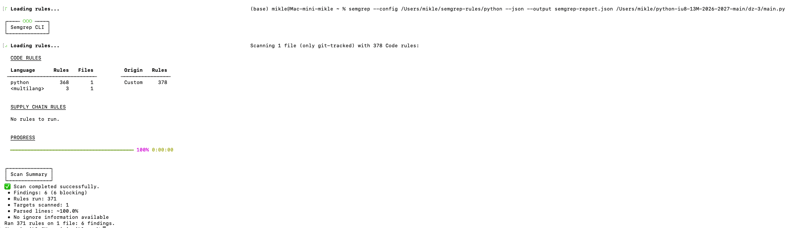

# Домашнее задание № 3

Статический анализ банковского TCP-сервера с помощью Semgrep

## Цель

Выполнить статический анализ main.py, разобрать срабатывания и сформулировать рекомендации по устранению выявленных проблем.

## Среда и ход работы

- ОС: macOS.
- Анализатор: Semgrep 1.181.0, движок OSS.
- Правила: локальный каталог semgrep-rules/python.
- Объект: dz-3/main.py.
- По сводке консоли выполнено 371 правило, проверен 1 файл.
- В JSON отсутствуют ошибки сканирования; получено 6 срабатываний.

```bash
semgrep --config /Users/mikle/semgrep-rules/python --json --output semgrep-report.json /Users/mikle/python-iu8-13M-2026-2027-main/dz-3/main.py
```

Проверка выполнялась без запуска сервера. Файлы клиента и демонстрационных атак не входили в область анализа.



## Результаты

В таблице приведены короткие имена правил; общий префикс идентификаторов: `semgrep-rules.python.lang.`. Для правил MD5 раздел - `security` (для md5-used-as-password - `security.audit`), для arbitrary-sleep - `best-practice`.

| № | Строка | Правило | Уровень | Анализ | Рекомендация |
|---|---|---|---|---|---|
| 1 | 52 | insecure-hash-algorithm-md5 | WARNING | MD5 при создании хеша пароля администратора. Быстрый алгоритм упрощает перебор паролей. | Использовать scrypt с индивидуальной случайной солью. |
| 2 | 55 | insecure-hash-algorithm-md5 | WARNING | MD5 при создании хеша пароля alice. Проблема подтверждается просмотром кода. | Использовать scrypt с индивидуальной случайной солью. |
| 3 | 58 | insecure-hash-algorithm-md5 | WARNING | MD5 при создании хеша пароля bob. Проблема подтверждается просмотром кода. | Использовать scrypt с индивидуальной случайной солью. |
| 4 | 142 | arbitrary-sleep | ERROR | time.sleep(0.05) задерживает перевод. При отсутствии блокировки увеличивает окно гонки между чтением баланса и его использованием. | Удалить задержку; защитить проверку и изменение балансов одной блокировкой или транзакцией БД. |
| 5 | 203 | insecure-hash-algorithm-md5 | WARNING | MD5 при вычислении хеша введённого пароля во время входа. | Перевести создание и проверку хешей на scrypt с солью. |
| 6 | 203 | md5-used-as-password | WARNING | MD5 используется именно для пароля. Пересекается со срабатыванием № 5 на той же операции. | Исправляется вместе со срабатыванием № 5. |

## Вывод

В результате статического анализа файла main.py инструментом Semgrep версии 1.181.0 получено шесть срабатываний по трём правилам: пять уровня WARNING и одно уровня ERROR. Обнаружено использование MD5 при создании и проверке хешей паролей, а также искусственная задержка в функции перевода денежных средств. Два срабатывания на строке 203 относятся к одной операции. Рекомендуется заменить MD5 специализированным алгоритмом хеширования паролей с индивидуальной солью и обеспечить атомарность операций с балансами. Проверка завершилась без ошибок. Отсутствие других срабатываний не подтверждает безопасность приложения: статический анализ необходимо дополнять ручной проверкой и функциональными испытаниями.
