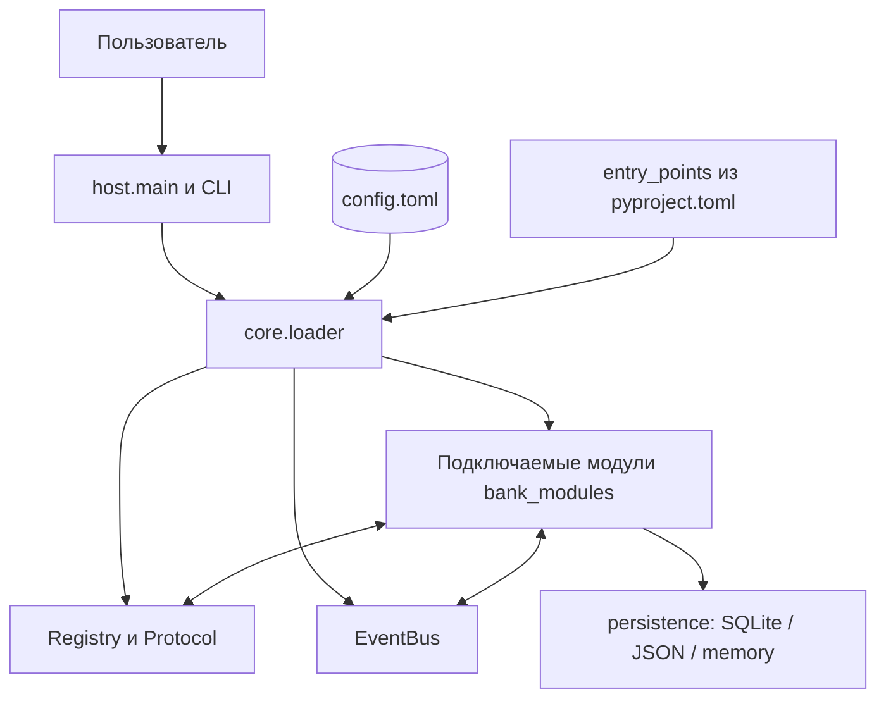
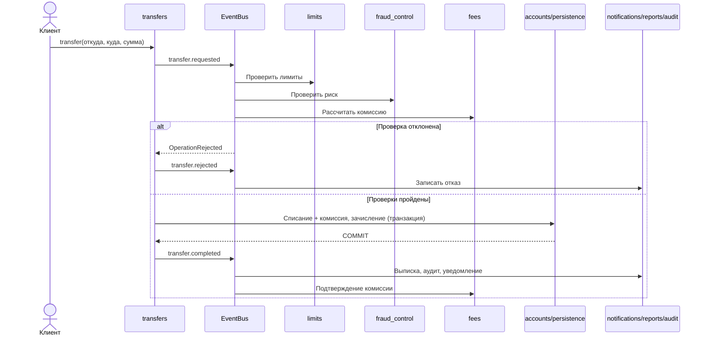

# Homework 5 — модульная банковская система

Консольное приложение на Python 3.11+ для работы со счетами и демонстрации плагинной архитектуры, слабой связанности и событийного взаимодействия. Все финансовые суммы внутри программы хранятся целыми числами в минимальных денежных единицах; при вводе пользователь указывает обычную сумму, например `150.50`.

## Запуск

Откройте терминал в каталоге `Python/Homework_5`:

```bash
python3 -m venv .venv
source .venv/bin/activate
python -m pip install -e .
python -m host.main
```

В Windows активация: `.venv\Scripts\activate`. После запуска доступна команда `help`, выход — `quit`. При первом запуске создаётся файл `bank.sqlite3`, если в `config.toml` выбран `storage_backend = "sqlite"`.

## Архитектура и принципы

Система разделена на независимое ядро, точку входа и плагины. `host` читает конфигурацию и запускает загрузчик; `core` предоставляет общие протоколы, реестр сервисов (`Registry`), шину событий (`EventBus`) и реестр консольных команд. `bank_modules` реализует банковские операции. В `pyproject.toml` плагины зарегистрированы как `entry_points`, а в `config.toml` задаётся порядок их включения.



**SRP:** каждый плагин отвечает за одну область: `auth` — пользователей, `accounts` — счета, `fees` — комиссии, `limits` — ограничения. **DIP:** функциональные модули запрашивают сервисы через интерфейсы `Protocol`, а не импортируют конкретные реализации друг друга. **Слабая связанность:** плагины реагируют на события и используют `Registry`; **высокая связность:** бизнес-правила сосредоточены внутри соответствующих пакетов.

## Состав модулей

| Модуль | Назначение |
|---|---|
| `core` | Контекст, загрузка, реестр, интерфейсы, события, CLI |
| `auth`, `accounts` | Регистрация, вход, счета и балансы |
| `deposits`, `withdrawals`, `transfers` | Пополнение, снятие, внутренние и имитируемые внешние переводы, обмен валют |
| `reports`, `notifications`, `persistence` | Выписки и экспорт, журнал уведомлений, хранение |
| `fees`, `limits`, `fraud_control` | Комиссии, дневные/месячные лимиты, антифрод |
| `bonus_points`, `currency` | Бонусы, фиксированные учебные курсы валют |
| `audit_log`, `admin`, `analytics` | Аудит, административные операции, статистика |

## Взаимодействие при переводе

Модуль перевода публикует запрос, который синхронно обрабатывают проверки. Если любой проверяющий обработчик вызывает `OperationRejected`, деньги не списываются. При успехе изменение балансов выполняется в одной транзакции хранилища; после фиксации публикуются события результата.



## Основные события

Система использует следующие обязательные события:

| Этап | События |
|---|---|
| Регистрация и авторизация | `user.registered`, `user.logged_in` |
| Счета | `account.opened`, `account.closed` |
| Пополнение | `deposit.requested`, `money.deposited` |
| Снятие | `withdrawal.requested`, `money.withdrawn` |
| Переводы | `transfer.requested`, `transfer.completed`, `transfer.rejected` |
| Комиссии и проверки | `fee.charged`, `fraud.detected` |
| Отмена | `operation.reversed` |

`EventBus.publish` применяется для синхронных проверок до операции; `EventBus.notify` уведомляет независимых подписчиков после фиксации результата. Ошибки уведомляющих обработчиков регистрируются, но уже зафиксированная транзакция автоматически не отменяется. Отмена завершённой операции оформляется отдельными компенсирующими проводками, а не удалением записи из истории.

## Пример работы

Каждую команду вводите отдельно в появляющуюся строку `bank>`:

```text
register alice alice@example.org password123
login alice password123
open current RUB
open savings RUB
deposit 1 1000
transfer 1 2 200
balance 1
balance 2
statement 1
bonuses
```

При чистой базе и комиссии 1% остатки будут `798 RUB` и `200 RUB`. Номера счетов могут отличаться, если база уже содержит записи. Команда `withdraw 1 999999` должна завершиться отказом без изменения баланса. Команды `expenses` и `top` показывают статистику, а административные функции требуют роли администратора.

## Конфигурация и хранение

В `config.toml` задаются активные плагины, комиссии, лимиты, порог антифрода, валютные курсы и тип хранения. Возможны `sqlite`, `memory`, `json`. JSON-режим реализован как снимок состояния SQLite, работающего в памяти. Внешние переводы и уведомления email/SMS являются учебными имитациями, реальные банковские и почтовые сервисы не подключены.

Для первоначальной проверки архитектуры достаточно убедиться, что отключение необязательного плагина в `config.toml` не ломает обязательные операции. Для воспроизводимых испытаний используйте отдельную базу и не публикуйте реальные пользовательские данные. Тесты, отчёт, графические схемы, сценарий демонстрации и средства проверки архитектуры находятся в соответствующих каталогах проекта.

## Выполненные расширенные требования

- [x] Роли клиента и администратора.
- [x] Комиссии за переводы (`fees`).
- [x] Дневные и месячные лимиты (`limits`).
- [x] Проверки подозрительных операций (`fraud_control`).
- [x] Бонусные баллы (`bonus_points`).
- [x] Мультивалютность и конвертация (`currency`).
- [ ] Автоматическое начисление процентов по накоплениям (`savings`).
- [ ] Кредиты с графиком платежей (`credits`).
- [ ] Отложенные и периодические платежи (`scheduler`).
- [x] Аудит действий (`audit_log`).
- [x] Административные команды (`admin`).
- [x] Аналитика расходов и популярных операций (`analytics`).
- [x] Экспорт выписки в CSV и JSON.
- [x] Компенсирующий откат операции через события.

## Структура и материалы для сдачи

```text
Homework_5/
├── .github/workflows/ci.yml
├── .importlinter
├── pyproject.toml
├── config.toml
├── README.md
├── src/
│   ├── core/
│   ├── bank_modules/
│   └── host/main.py
├── tests/
│   ├── test_accounts.py
│   ├── test_transfers.py
│   ├── test_isolation.py
│   └── ...
├── scripts/
│   ├── check_macos.sh
│   └── run_demo.py
└── docs/
    ├── report.md
    ├── diagrams/
    └── screenshots/
```

Для проверки: `python -m pip install -e . pytest import-linter`, затем `python -m pytest -q`, `lint-imports` и `python scripts/run_demo.py`. В `docs/screenshots/` приложен реальный текст демонстрационного запуска; изображения экрана защиты необходимо сделать самостоятельно.
