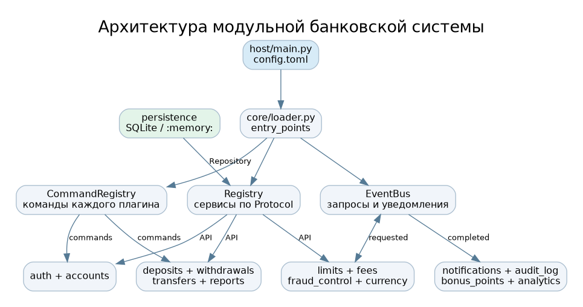
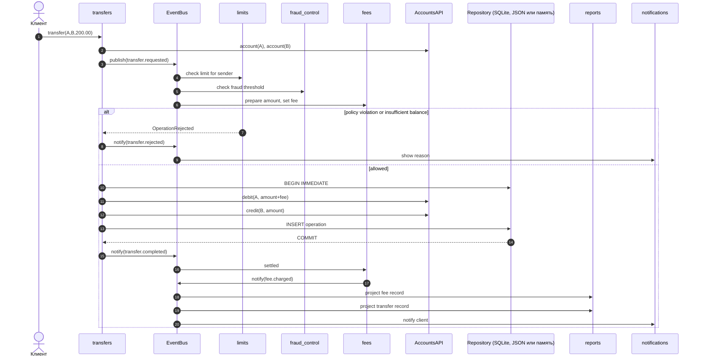
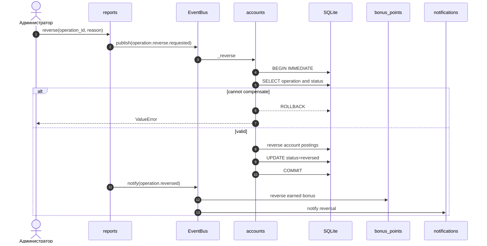

# ДЗ-5 — событийная архитектура банковской системы (v4)

## 1. Назначение и инженерные решения

Реализовано консольное банковское приложение на Python (пакеты `src/core`, `src/bank_modules`, `src/host`). **Реализованы 14 событийных контрактов** и имеет валидатор обязательных полей. При этом не все события обладают одинаковым эффектом: есть *предоперационные* (`*.requested`), которые могут запретить операцию, и *события результата* (`*.completed`, `*.deposited` и т. п.), которые испускаются только после подтверждения транзакции.

`core.events.EventBus.publish()` синхронно выполняет подписчиков с возможностью поднять `OperationRejected`; `EventBus.notify()` запускает всех подписчиков и фиксирует ошибки в `EventBus.errors` и `notification.error`. Существование ошибки наблюдателя **не отменяет уже совершённую проводку**. Сам `EventBus` пока синхронный и не реализует долговременную очередь повторной доставки; долговременная очередь повторной доставки отсутствует.

Плагины не импортируют друг друга. `core.registry.Registry` выдаёт сервисы по `Protocol`; в частности, `accounts` предоставляет API списания/зачисления, а `persistence` — Repository (SQLite, JSON или память). `fees` участвует в `transfer.requested` как подписчик и добавляет комиссию в payload. Загрузка модулей выполняется через `entry_points`. Инициализация и регистрация команд разделены.

Учет сумм в целых копейках, перевод через `Decimal`; запись двух проводок и операции — одна транзакция SQLite (`BEGIN IMMEDIATE` / `COMMIT` / `ROLLBACK`). Защита действий по владельцу счёта есть в интерактивном CLI. Внешние банковские расчёты не выполняются; финансовые операции ведутся во внутреннем хранилище приложения.

## 2. Архитектура

- `core/module.py`: абстракция плагина и контекст.
- `core/events.py`: 14 контрактов, `EventBus`, veto и обработка сбоев подписчиков.
- `core/protocols.py`: интерфейсы без импортов бизнес-реализаций.
- `core/registry.py`: реестр сервисов.
- `core/loader.py`: обнаружение плагинов через `entry_points`.
- `core/cli.py`: реестр команд и пользовательская сессия.
- `host/main.py`: вход, чтение `config.toml`, запуск командного интерфейса.

## 3. Полная матрица обязательных событий

| Событие | Публикует | Подписчики | Обязательные поля payload | Логика |
|---|---|---|---|---|
| `user.registered` | `auth` | notifications, audit_log | `user_id, login, role` | Хеширование пароля → INSERT users → COMMIT → журнал и уведомление |
| `user.logged_in` | `auth` | audit_log, fraud_control | `user_id, ts` | PBKDF2 + проверка блокировки → аудит → счётчик успешных входов |
| `account.opened` | `accounts` | notifications, reports, audit_log | `account_id, owner_id, type, currency` | Проверка клиента/типа/валюты → INSERT счета → проекция и уведомление |
| `account.closed` | `accounts` | notifications, reports, audit_log | `account_id` | Проверка нулевого баланса → закрытие → запись в проекцию |
| `deposit.requested` | `deposits` | limits, fraud_control, audit_log | `account_id, amount, currency` | Предпроверка максимума пополнения и риска; исключение останавливает запись |
| `money.deposited` | `deposits` | notifications, reports, bonus_points, audit_log | `operation_id, account_id, amount, currency, ts` | После COMMIT: уведомить, записать в проекцию и начислить идемпотентные бонусы |
| `withdrawal.requested` | `withdrawals` | limits, fraud_control, audit_log | `account_id, amount` | Дневной+месячный лимиты, антифрод, затем атомарный дебет |
| `money.withdrawn` | `withdrawals` | notifications, reports, analytics, audit_log | `operation_id, account_id, amount, ts` | После COMMIT: история, аналитика и уведомление |
| `transfer.requested` | `transfers` | limits, fraud_control, fees, audit_log | `from, to, amount, currency` | Гварды могут отклонить; fees добавляет тариф в request payload; далее атомарные проводки |
| `transfer.completed` | `transfers` | notifications, reports, bonus_points, fees, audit_log | `operation_id, from, to, amount, fee, ts` | После COMMIT: комиссия, история, бонусы, уведомления |
| `transfer.rejected` | `transfers` | notifications, audit_log, fees | `from, to, amount, reason` | Неудачная операция не меняет баланс, фиксируется причина отказа |
| `fee.charged` | `fees` | reports, audit_log | `operation_id, account_id, fee` | Модуль fees публикует событие только после подтверждения перевода |
| `fraud.detected` | `fraud_control` | admin, notifications, audit_log | `user_id, operation, reason` | Фиксация инцидента → уведомление администратора → запрет исходной операции |
| `operation.reversed` | `reports` | accounts, notifications, audit_log, bonus_points | `operation_id, reason` | Админ инициирует; accounts атомарно компенсирует; reports сообщает результат; бонусы отменяются |

### 3.1. Контракт `operation.reversed`

Перед публикацией `operation.reversed` интерфейс `reports.reverse(...)` публикует дополнительное внутреннее событие `operation.reverse.requested`. Обработчик модуля `accounts` проверяет статус операции, проводит компенсацию по типу (`deposit`, `withdrawal`, `transfer`, `external_transfer`, `exchange`) **в одной SQLite-транзакции** и помечает её `reversed`. При невозможности вернуть деньги, например если получатель их уже снял, транзакция откатывается и `operation.reversed` не публикуется. Двойной откат запрещён. После успешной компенсации публикуется `operation.reversed`, модуль `bonus_points` отменяет начисленные по исходной операции бонусы. В консоли команда доступна только роли admin: `reverse OPERATION_ID REASON`.

### 3.2. Границы реализации

В отличие от полноценной распределенной банковской системы, здесь нет durable outbox, брокера сообщений, двухфазной фиксации или доказанной доставки уведомлений. Сбои post-commit обработчиков регистрируются в памяти в `ctx.events.errors`, и требуется ручное устранение причины. Обмен валют использует фиксированные курсы из конфигурации; комиссия из `transfer.requested` удерживается в исходной валюте и возвращается при компенсирующем откате. Уведомления `email`/`sms` — заглушки.

## 4. Подробные схемы событийных сценариев

Диаграммы последовательности представлены файлами PNG и соответствующими исходными Graphviz-файлами.

| Сценарий | Иллюстрация |
|---|---|
| Регистрация / вход (`user.registered`, `user.logged_in`) | [onboarding.png](diagrams/onboarding.png) |
| Счета (`account.opened`, `account.closed`) | [accounts.png](diagrams/accounts.png) |
| Пополнение (`deposit.requested`, `money.deposited`) | [deposit.png](diagrams/deposit.png) |
| Снятие (`withdrawal.requested`, `money.withdrawn`) | [withdrawal.png](diagrams/withdrawal.png) |
| Перевод и комиссия (`transfer.requested`, `transfer.completed`, `fee.charged`) | [transfer.png](diagrams/transfer.png) |
| Отказ и антифрод (`transfer.rejected`, `fraud.detected`) | [rejection.png](diagrams/rejection.png) |
| Откат (`operation.reversed`) | [reversal.png](diagrams/reversal.png) |

### Перевод: полноценная диаграмма последовательности

### Откат: отдельная диаграмма

## 5. Проверка

Команды проверки: `python -m pip install -e . pytest import-linter`, `python -m pytest -q`, `lint-imports`. Тесты покрывают контрактный список, схему подписчиков, операции с комиссиями, блокировку по лимитам, антифрод, отмену бонусов при откате, повторный откат и атомарность. Архитектурные зависимости проверяются средствами `import-linter`.

## 6. Исправления в версии 4 и границы гарантий

1. `transfers.exchange()` учитывает `fee`, который обработчик `fees.prepare()` добавляет в
   `transfer.requested`, списывает `amount + fee` в исходной валюте, сохраняет сумму комиссии
   и передаёт её в `transfer.completed`; `fees.settled()` публикует `fee.charged`.
2. `accounts._reverse()` возвращает и сумму обмена, и комиссию, а
   `accounts._reversed()` **проверяет**, что компенсация уже подтверждена БД.
   `operation.reverse.requested` остаётся синхронной командой до COMMIT,
   `operation.reversed` — событием свершившегося факта после COMMIT.
3. `analytics.expenses()` и `analytics.top()` группируют расходы по операциям
   и исключают статусы `reversed`. Категория задаётся типом
   операции; MCC/назначения платежа в исходных данных нет.
4. Переключение `storage_backend`: `sqlite` / `memory` / `json`.
   JSON хранит SQL-дамп в JSON-документе, а SQL выполняется SQLite в памяти;
   сохранение — атомарная замена файла. Это адаптер хранения
   взаимозаменяемости, не самостоятельная JSON-реализация SQL.
5. События post-commit по-прежнему обрабатываются синхронно, ошибки
   собираются в `EventBus.errors`; durable outbox/повторные попытки **не реализованы**.
   Следовательно, наблюдатели в случае сбоя могут отставать от факта денежной
   операции. Это не промышленная банковская обработка.
