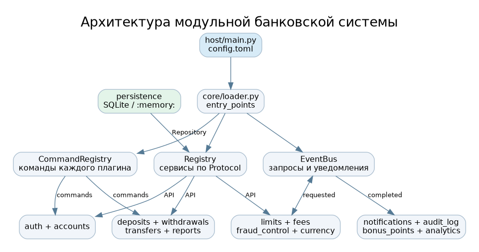
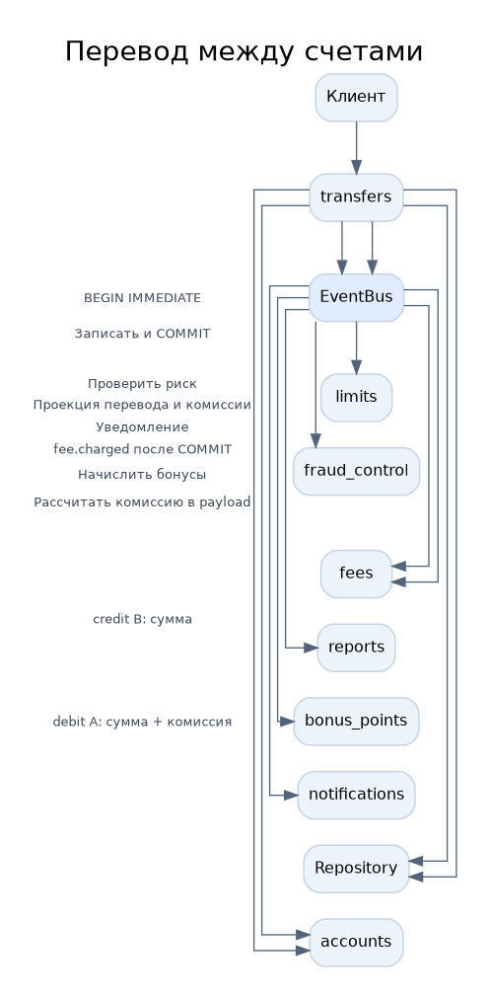
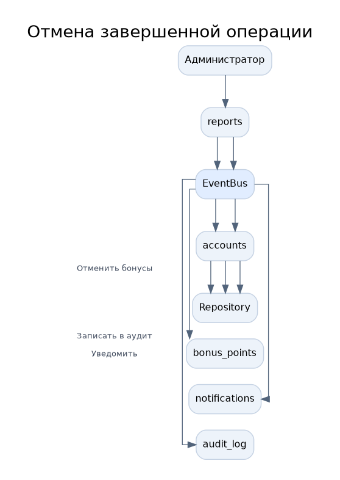

# Отчёт о выполнении ДЗ-5 «Модульная банковская система на Python»

**Дисциплина:** программирование на Python, группа ИУ8-13М  
**Работа:** ДЗ-5  
**Исполнитель:** Бочкарев Михаил Александрович  
**Версия:** 4.0, дополненная независимыми испытаниями событийной шины  
**Основа требований:** [репозиторий преподавателя, dz-5/readme.md](https://github.com/Kulikova-A18/python-iu8-13M-2026-2027/blob/main/dz-5/readme.md)

## 1. Цель работы

Разработка модульной консольной банковской системы с высокой связностью компонентов внутри отдельных модулей, слабой связанностью между модулями, загрузкой расширений через `entry_points`, обменом событиями через `EventBus` и предоставлением интерфейсов через `Protocol` / `Registry`.

## 2. Структура и архитектурные решения

- `src/core/module.py` — интерфейс модуля и `ModuleContext`.
- `src/core/protocols.py` — независимые контракты сервисов.
- `src/core/registry.py` — получение сервиса по интерфейсу.
- `src/core/events.py` — синхронная шина запросов и уведомлений с проверкой полей событий.
- `src/core/loader.py` — обнаружение подключённых модулей через `entry_points`.
- `src/core/cli.py` — независимый реестр консольных команд и сессия пользователя.
- `src/host/main.py` — запуск приложения по `config.toml`.
- `src/bank_modules/` — самостоятельные пакеты модулей без прямых импортов друг друга.
- `.importlinter` — независимые архитектурные контракты.
- `.github/workflows/ci.yml` — CI для тестов и проверок импортов.



В ядре нет импортов конкретных бизнес-плагинов. Плагины взаимодействуют через `Repository`, `AccountsAPI` и другие интерфейсы, а также через именованные события. Модули регистрируют свои консольные команды самостоятельно. Конфигурация определяет перечень подключаемых модулей.

## 3. Реализованные модули

**Обязательные девять компонентов:** `core`, `auth`, `accounts`, `deposits`, `withdrawals`, `transfers`, `reports`, `notifications`, `persistence`.

**Восемь дополнительных:** `fees`, `limits`, `fraud_control`, `bonus_points`, `currency`, `audit_log`, `admin`, `analytics`.

Функциональность: регистрация, вход, роли, открытие и закрытие счетов, пополнение, снятие, внутренние и имитируемые внешние переводы, обмен валют по заданным курсам, комиссии, лимиты, антифрод, бонусы, аудит, уведомления, выписки с фильтрами, экспорт CSV/JSON, административная блокировка пользователей и компенсационная отмена операции. Поддерживаются режимы `sqlite`, `memory` и `json`.

## 4. Событийное взаимодействие

| Обязательное событие | Инициатор | Назначение |
|---|---|---|
| `user.registered` | auth | Уведомление о регистрации, аудит |
| `user.logged_in` | auth | Аудит авторизации и реакция антифрода |
| `account.opened` | accounts | Проекция истории, уведомление |
| `account.closed` | accounts | Проекция истории, уведомление |
| `deposit.requested` | deposits | Проверка пополнения до изменения баланса |
| `money.deposited` | deposits | История, бонусы, уведомление после транзакции |
| `withdrawal.requested` | withdrawals | Лимиты и антифрод до списания |
| `money.withdrawn` | withdrawals | История, аналитика и уведомление |
| `transfer.requested` | transfers | Проверки и расчёт комиссии |
| `transfer.completed` | transfers | Фиксация совершённого перевода у подписчиков |
| `transfer.rejected` | transfers | Регистрация отказа и его причины |
| `fee.charged` | fees | Регистрация взысканной комиссии |
| `fraud.detected` | fraud_control | Уведомление администрирования и аудит |
| `operation.reversed` | reports | Подтверждение компенсации, отзыв бонусов, уведомления |

События `*.requested` выполняются через `publish()`: исключение подписчика останавливает банковскую команду до проводки. Уведомления об уже зафиксированных фактах выполняются через `notify()`: исключение одного наблюдателя регистрируется в `EventBus.errors`, остальные наблюдатели продолжают обработку. Для отмены используется внутреннее предварительное событие `operation.reverse.requested`, а после успешного изменения статуса — `operation.reversed`.





Полное описание подписчиков, контрактов payload и остальных иллюстраций: [docs/report.md](docs/report.md).

## 5. Проверка правильности работы

### 5.1. Результаты на компьютере разработчика (macOS, предоставленный протокол)

- `python -m pytest -v` — **30 passed in 1.80s** (Python 3.13.5, macOS).
- `lint-imports` — **2 kept, 0 broken**, 25 файлов и 37 зависимостей.
- `python -m host.main` — запуск успешен; зарегистрирован пользователь, созданы счета, выполнены пополнение и внешний перевод, успешно отклонено снятие сверх баланса, доступны выписка, бонусы и статистика.

При вставке нескольких команд в интерактивную консоль были получены `Unknown command: accountstransfer` и `Unknown command: statswithdraw`: это **склеивание строк при вставке**, а не ошибка выполнения банковской операции. Команда `notifications` возвращала отказ из-за отсутствия прав администратора — это ожидаемый контроль доступа.

### 5.2. Дополнительные локальные испытания в изолированной среде

Добавлен файл `tests/test_fault_resilience.py` с четырьмя тестами:

1. Подписчик отклоняет `transfer.requested`: нет списания, не создаётся завершённый перевод, публикуется `transfer.rejected`.
2. Подписчик `transfer.completed` падает после COMMIT: денежная проводка остаётся выполненной, следующий подписчик вызывается, ошибка регистрируется.
3. Неверный payload обязательного события отклоняется валидатором.
4. Поддельное `operation.reversed` без реальной компенсации обнаруживается обработчиком модуля `accounts`.

**Результат локального прогона:** `34 passed in 2.47s` (30 ранее существовавших + 4 дополнительных теста).

Добавлен `scripts/run_demo.py`: сценарий с отдельной временной БД, регистрацией, двумя счетами, пополнением на 1000 RUB, переводом 200 RUB и комиссией 1%, проверкой остатков **798 RUB / 200 RUB**, отказом в снятии 5000 RUB, просмотром выписки, бонусов и аналитики. **Результат:** `DEMO PASSED`. Действующая пользовательская БД при демонстрации не меняется.

### 5.3. Инструкция воспроизведения на macOS

```bash
cd /путь/к/bank-system
python3 -m venv .venv
source .venv/bin/activate
python -m pip install -e . pytest import-linter
python -m pytest -q
lint-imports
python scripts/run_demo.py
python -m host.main
```

Или выполнить `bash scripts/check_macos.sh` после активации окружения. В интерактивной консоли необходимо вводить **по одной команде и нажимать Enter**, либо пользоваться скриптом демонстрации.

### 5.4. Проверка CI

В `.github/workflows/ci.yml` предусмотрены установка Python 3.11, установка проекта и зависимостей, `lint-imports`, `pytest`, автоматический демонстрационный сценарий. Фактическое выполнение workflow на GitHub необходимо подтвердить зелёным статусом Actions после публикации репозитория.

## 6. Оценка выполнения требований

| Пункт задания | Выполнение |
|---|---|
| 9 обязательных компонентов | Выполнено |
| Не менее 4 дополнительных модулей | Выполнено (8) |
| Не менее 8 расширенных возможностей | Выполнено |
| Все 14 обязательных событий и требуемые поля payload | Выполнено |
| Обязательный банковский сценарий | Выполнено |
| Слабая связанность импортов и конфигурация | Подтверждено `import-linter` |
| Подключение через `entry_points` | Выполнено |
| Сменное хранилище | SQLite, память, JSON-снимок |
| Тесты банковских операций и независимости | 34 пройденных теста |
| Структура, отчёт, схемы | Выполнено |
| GitHub Actions в публичном репозитории | Конфигурация подготовлена, запуск на GitHub ещё не подтверждён |

## 7. Ограничения и вывод

Приложение разработано для учебного использования. Внешние платежи, email и SMS имитируются; валютные курсы фиксированные. JSON-режим реализован через SQLite в памяти с сохранением SQL-дампа в JSON. Post-commit обработчики не имеют долговременной очереди повторной доставки: при их сбоях операция остаётся подтверждённой, а ошибка отражается в журнале `EventBus.errors`; возможно расхождение вторичных проекций и бонусов до восстановления. Аналитические суммы разных валют напрямую не следует сравнивать без пересчёта к общей валюте.

**Вывод:** разработаны модульная банковская система и средства автоматической проверки основной функциональности, архитектурных ограничений и сценариев отказов. Требуемые модули, события и минимальные расширенные возможности реализованы. Проверка CI на GitHub и испытания надёжности с принудительным аварийным завершением процесса остаются отдельными процедурами и не заявляются как выполненные.
