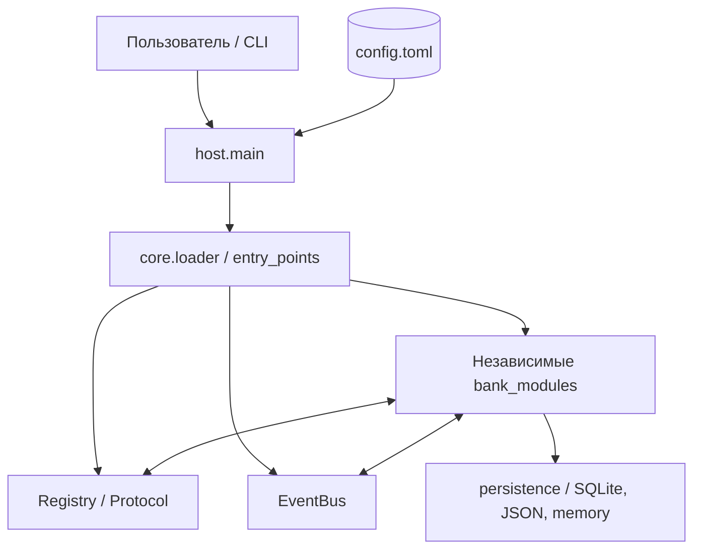
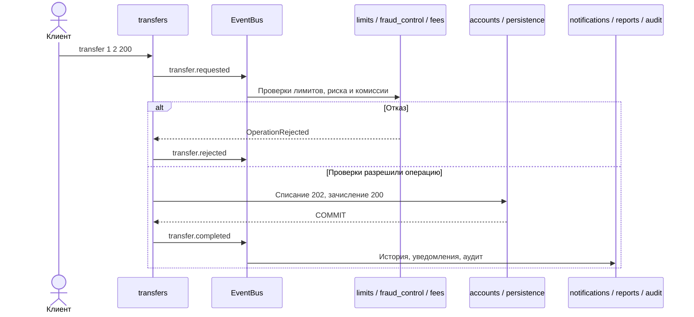
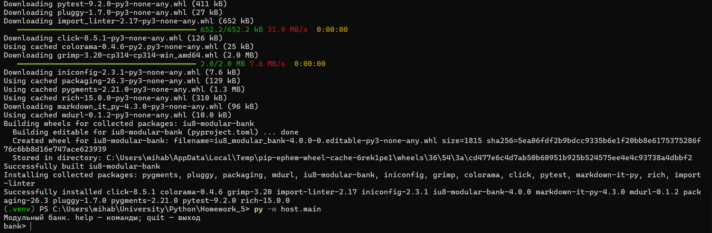
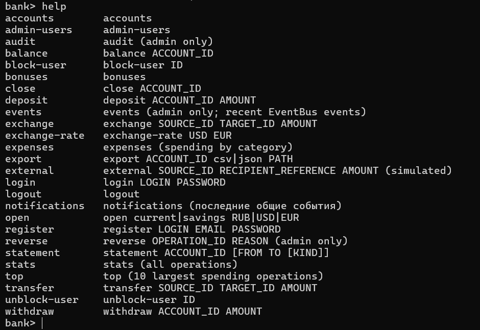
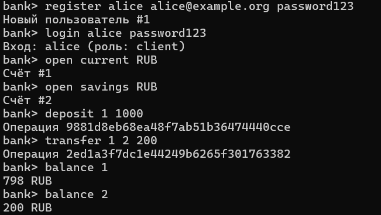
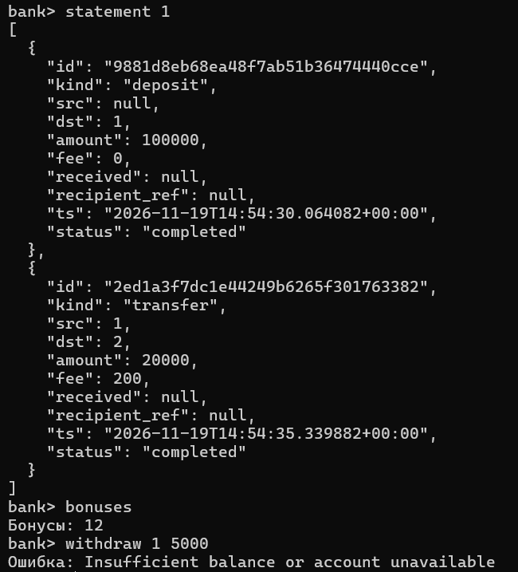
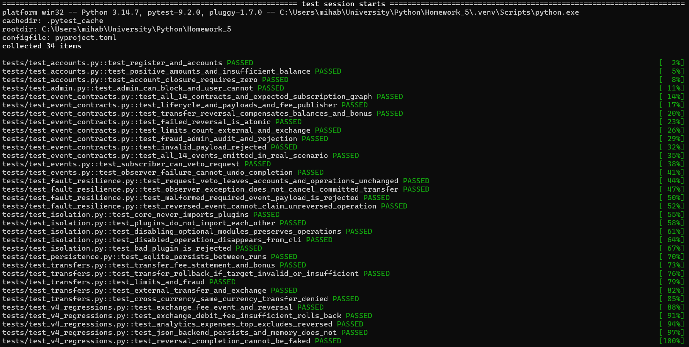
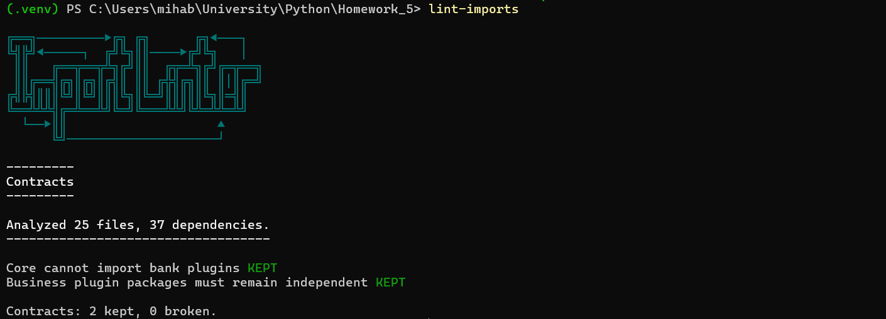

# ДЗ-5. Модульная банковская система на Python — отчёт о запуске и работе

> **Назначение отчёта:** воспроизводимая демонстрация работы программы и подтверждение требований домашнего задания № 5. Все иллюстрации ниже — скриншоты реального запуска программы в Windows PowerShell. Исходный код, тесты и настройки находятся в текущем каталоге `Homework_5`.

## 1. Цель и постановка задачи

Требуется реализовать консольную банковскую систему с независимыми модулями, плагинной загрузкой, общими контрактами, событийным взаимодействием и возможностью включения и отключения дополнительных функций. Обязательны девять базовых компонентов (`core`, `auth`, `accounts`, `deposits`, `withdrawals`, `transfers`, `reports`, `notifications`, `persistence`), минимум четыре дополнительных модуля, не менее восьми расширенных возможностей и 14 событийных контрактов.

Реализация включает 16 подключаемых банковских пакетов, ядро, консольную оболочку, операции со счетами, комиссии, ограничения, антифрод, статистику, аудит, административные команды, бонусы и экспорт. Проект учебный: внешние переводы и каналы email/SMS имитируются, а курсы валют заданы конфигурацией.

## 2. Структура проекта и принцип функционирования

```text
Homework_5/
├── pyproject.toml           # пакет и точки входа плагинов
├── config.toml             # активные модули, комиссии и лимиты
├── .importlinter           # архитектурные ограничения импортов
├── src/
│   ├── host/main.py        # точка запуска
│   ├── core/               # Registry, EventBus, Protocol, загрузчик, CLI
│   └── bank_modules/       # независимые модули банковских операций
├── tests/                  # функциональные и архитектурные тесты
├── scripts/                # проверочный сценарий
└── docs/                   # технический отчёт, схемы и демонстрация
```



**SRP:** у каждого плагина собственная предметная область — например, `fees` отвечает за комиссию, а `limits` — за ограничения. **DIP:** зависимости от банковских сервисов задаются через `typing.Protocol` и `Registry`, а не прямыми импортами между плагинами. **Слабая связанность** достигается через EventBus и реестр интерфейсов. **Высокая связность** — за счёт группировки связанных операций в одном пакете.

### Обработка перевода



Суммы учитываются целыми числами в копейках; запись денежной операции и изменение балансов выполняются атомарно. Предоперационные события могут заблокировать проведение операции, а события результата публикуются после её завершения. `EventBus.notify()` изолирует сбои наблюдателей от уже зафиксированной операции.

**Обязательные события:** `user.registered`, `user.logged_in`, `account.opened`, `account.closed`, `deposit.requested`, `money.deposited`, `withdrawal.requested`, `money.withdrawn`, `transfer.requested`, `transfer.completed`, `transfer.rejected`, `fee.charged`, `fraud.detected`, `operation.reversed`.

## 3. Запуск на Windows

Открыть PowerShell в `Python/Homework_5`. Нужен Python **3.11+**. В демонстрации использовался Python 3.14.7.

```powershell
py --version
py -m venv .venv
Set-ExecutionPolicy -Scope Process -ExecutionPolicy Bypass
.\.venv\Scripts\Activate.ps1
python -m pip install -e . pytest import-linter
py -m host.main
```

Если запуск скриптов PowerShell запрещён, активация необязательна: можно выполнять команды с префиксом `.\.venv\Scripts\python.exe`. Для повторного запуска используется `py -m host.main` в активированном окружении. Параметры задаются в `config.toml`; SQLite создаёт файл `bank.sqlite3` в рабочем каталоге.



*Рисунок 1 — установка проекта и появление приглашения `bank>`.*

## 4. Демонстрация основных возможностей

### 4.1. Доступные команды

Внутри CLI ввести `help`. Программа показывает команды регистрации, счетов, операций, выписок и дополнительных модулей.



*Рисунок 2 — автоматически зарегистрированные команды подключённых плагинов.*

### 4.2. Регистрация, счета, пополнение и перевод

Команды нужно вводить **по одной строке** после `bank>`:

```text
register alice alice@example.org password123
login alice password123
open current RUB
open savings RUB
deposit 1 1000
transfer 1 2 200
balance 1
balance 2
```

На демонстрации создан пользователь №1 и два рублёвых счёта №1 и №2. После пополнения первого счёта на **1000 RUB** выполнен перевод **200 RUB** на второй счёт. При комиссии **1 % (2 RUB)** остаток отправителя равен **798 RUB**, получателя — **200 RUB**. Номера счетов в другой базе могут отличаться.



*Рисунок 3 — исполнение реального сценария с проверкой денежного баланса.*

### 4.3. История, бонусы и отказ в недопустимой операции

```text
statement 1
bonuses
withdraw 1 5000
balance 1
```

В выписке видны `deposit` на 100000 копеек и `transfer` на 20000 копеек с комиссией 200 копеек; обе операции завершены со статусом `completed`. На скриншоте начислено **12 бонусов**. Попытка снять 5000 RUB при остатке 798 RUB отклоняется с сообщением `Insufficient balance or account unavailable`. Операция отказа не должна изменять остаток.



*Рисунок 4 — выписка, бонусные баллы и защитная проверка достаточности средств.*

### 4.4. Дополнительные функции

Команды `external`, `exchange`, `expenses`, `top`, `export` реализуют имитацию внешнего перевода, обмен валют, аналитику и выгрузку выписки. Сценарии `reverse` и `audit` доступны администратору. Дневные и месячные лимиты и антифрод проверяются до фиксации операций. В отличие от обычного удаления записи, `reverse` создаёт компенсирующее действие, оставляя историю операции. Соответствующие проверки включены в набор тестов.

## 5. Автоматическая проверка

Выполнить после выхода из банка командой `quit`:

```powershell
py -m pytest -v
lint-imports
```

В присланном результате **34 теста обнаружены и помечены `PASSED`**. Они покрывают регистрацию, счета, атомарные переводы, комиссии, лимиты, антифрод, сохранение SQLite/JSON, отчёты, события, откаты, изоляцию модулей и реакцию на сбои подписчиков.



*Рисунок 5 — 34 успешных теста, прогресс 100 %.*

`import-linter` исследовал **25 файлов и 37 зависимостей**, подтвердив оба правила: `core` не импортирует банковские плагины; бизнес-плагины не импортируют друг друга. **`Contracts: 2 kept, 0 broken`**.



*Рисунок 6 — успешно соблюдены два архитектурных контракта.*

## 6. Соответствие требованиям

| Требование | Реализация / доказательство |
|---|---|
| Независимые модули и ядро | `src/core`, `src/bank_modules`, интерфейсы Protocol; рис. 2, 6 |
| Плагины и конфигурация | `entry_points` в `pyproject.toml`, список модулей в `config.toml` |
| 9 обязательных базовых компонентов | `core` и 8 обязательных бизнес-/инфраструктурных модулей |
| ≥4 дополнительных модуля | `fees`, `limits`, `fraud_control`, `bonus_points`, `currency`, `audit_log`, `admin`, `analytics` |
| ≥8 расширенных возможностей | Роли, комиссии, лимиты, антифрод, бонусы, валюты, аудит, администрирование, аналитика, экспорт, reversal |
| 14 событий | Контракты `core/events.py`, проверка `test_event_contracts.py` |
| Основной сценарий | Рисунки 3–4: регистрация, счета, пополнение, перевод, выписка, отказ |
| Автоматическое тестирование | Рисунок 5: 34 `PASSED` |
| Запрет прямых зависимостей | Рисунок 6: 2 `KEPT`, 0 нарушений |

## 7. Заключение

Система запускается как расширяемое консольное приложение, выполняет банковские операции и сохраняет историю, применяя комиссии и проверки до проведения транзакций. Демонстрация показывает корректный перерасчёт балансов и отказ при недостатке средств. **34 функциональных теста и 2 архитектурных контракта** подтверждены реальным запуском. Границы модели: приложение учебное, без реальных внешних банковских сервисов и гарантированной очереди доставки уведомлений.