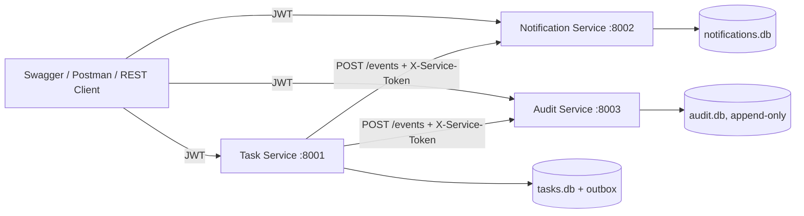
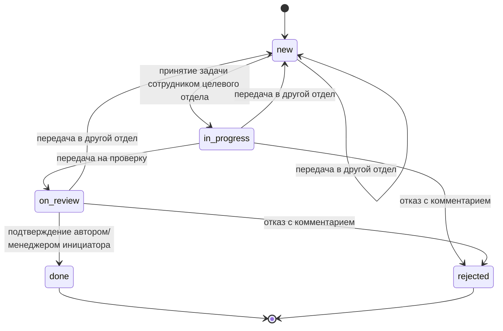

# Система управления межотдельскими задачами банка

Три независимых HTTP-микросервиса на Python 3.11+ и FastAPI: **Task Service**, **Notification Service**, **Audit Service**. Система поддерживает справочник отделов и сотрудников, JWT-авторизацию, создание и обработку задач, комментарии, уведомления и неизменяемую историю действий. Каждый сервис имеет собственный SQLite-файл на отдельном Docker volume. Интеграция между сервисами осуществляется только по HTTP.

**Результаты проверки:** [Отчёт о реализации и испытаниях](ОТЧЕТ_ЗАЩИТА.md) — функциональные сценарии, отказоустойчивость Notification/Audit, результат 27 автоматических тестов.

## Архитектура



**Task Service** объединяет предметную логику задач со справочником сотрудников, отделов и входом через JWT. **Notification Service** получает `task_created`, `status_changed`, `task_updated`, `comment_added`, `deadline_near` и сохраняет уведомления. **Audit Service** принимает те же события и хранит историю в режиме *только добавление*. У каждого сервиса — слои `api.py`, `services.py`, `repositories.py`, `schemas.py`. Общие stateless-контракты и функции находятся в `common/`, без совместного доступа к базе данных.

### Схема состояний



Непредусмотренные переходы возвращают **HTTP 409**. Отклонение требует комментария. Передача задачи в другой отдел сбрасывает состояние в `new`. Изменения задачи выполняются внутри SQLite-транзакции.

## Запуск Docker Compose

Требования: Docker Engine / Docker Desktop с Docker Compose v2, доступные порты 8001–8003.

```powershell
cd Python/Homework_6
Copy-Item .env.example .env
# Измените BOOTSTRAP_ADMIN_PASSWORD, JWT_SECRET и SERVICE_API_KEY в .env
docker compose up --build
```

На Linux/macOS: `cp .env.example .env` и `docker compose up --build`.

| Сервис | Swagger | Healthcheck | Хранилище |
|---|---|---|---|
| Task | http://localhost:8001/docs | http://localhost:8001/health | `task_data:/data` |
| Notification | http://localhost:8002/docs | http://localhost:8002/health | `notification_data:/data` |
| Audit | http://localhost:8003/docs | http://localhost:8003/health | `audit_data:/data` |

```powershell
docker compose ps
docker compose logs -f task
docker compose down
```

`docker compose down` сохраняет базы на volumes. `docker compose down -v` **удаляет данные**. Контейнеры `notification` и `audit` должны стать `healthy` до запуска `task` (`depends_on: condition: service_healthy`). Для healthcheck используется Python `urllib.request`, без `curl`.

Все адреса, порты, пути к базам, учётная запись начального администратора и время повторной доставки определяются `.env` (`.env.example` содержит пример). Файл `.env` исключён из Git. Начальный администратор создаётся **только в пустой базе Task Service**. Плановая проверка приближающихся сроков выполняется раз в `DEADLINE_SCAN_SECONDS` (по умолчанию раз в 5 минут) или вручную через `POST /deadlines/scan`.

## Справочник и доступ

В новой базе автоматически создаются четыре отдела: `CREDIT`, `COMPLIANCE`, `OPERATIONS`, `IT`. Начальный пользователь — `admin`, пароль берётся из `BOOTSTRAP_ADMIN_PASSWORD`.

| Роль | Права |
|---|---|
| `admin` | Управление отделами и сотрудниками, просмотр всех задач и аудита, запуск повторной доставки событий |
| `manager` | Управление задачами своего отдела, просмотр истории своего отдела, контроль сроков |
| `employee` | Создание задач, работа с назначенными задачами, комментарии, просмотр доступных задач и уведомлений |

Для действий на Task, Notification и Audit API используется **Bearer JWT**, выданный `POST /auth/login` или `POST /auth/login-json` основного сервиса. Пароли сохраняются в виде PBKDF2-HMAC-SHA256 с уникальной солью. Токен действителен 8 часов. Для внутреннего приёма событий используется отдельный заголовок `X-Service-Token` из `.env`; передавать его клиентам нельзя.

### Пример работы в PowerShell

```powershell
$task = 'http://localhost:8001'
$login = Invoke-RestMethod -Method Post -Uri "$task/auth/login-json" `
  -ContentType 'application/json' `
  -Body '{"login":"admin","password":"change-this-password"}'
$headers = @{Authorization="Bearer $($login.access_token)"}
Invoke-RestMethod "$task/departments" -Headers $headers
Invoke-RestMethod -Method Post -Uri "$task/tasks" -Headers $headers `
  -ContentType 'application/json' `
  -Body '{"title":"Проверить кредитную заявку","to_department":2,"priority":"high","description":"Проверка документов"}'
Invoke-RestMethod "$task/tasks?status=new&priority=high" -Headers $headers
Invoke-RestMethod 'http://localhost:8002/notifications?department=2' -Headers $headers
Invoke-RestMethod 'http://localhost:8003/audit?task_id=1' -Headers $headers
```

В примере пароль должен соответствовать значению `BOOTSTRAP_ADMIN_PASSWORD` в `.env`. ID отделов и задач следует брать из реальных ответов API; начальные отделы обычно имеют ID 1–4. Для смены статуса на `in_progress` следует войти сотрудником принимающего отдела. В Swagger кнопка **Authorize** принимает JWT.

## HTTP API

| Сервис | Метод и путь | Назначение |
|---|---|---|
| Task | `POST /auth/login`, `POST /auth/login-json` | Вход, получение JWT |
| Task | `GET /auth/me` | Текущая учётная запись |
| Task | `GET /departments`, `POST /departments` | Справочник отделов |
| Task | `GET /employees`, `POST /employees` | Сотрудники и роли |
| Task | `PATCH /departments/{id}/manager` | Назначение менеджера отдела |
| Task | `PATCH /employees/{id}/state` | Активация и деактивация сотрудника |
| Task | `POST /tasks`, `GET /tasks`, `GET /tasks/{id}` | Создание, фильтрация и просмотр |
| Task | `PATCH /tasks/{id}` | Редактирование задачи |
| Task | `POST /tasks/{id}/status` | Переход состояния с контролем прав |
| Task | `POST /tasks/{id}/transfer` | Передача другому отделу |
| Task | `GET/POST /tasks/{id}/comments` | Комментарии |
| Task | `POST /deadlines/scan` | События приближающихся сроков (один раз в день на задачу) |
| Task | `GET /outbox`, `POST /outbox/retry` | Очередь и повторная доставка (admin) |
| Notification | `POST /events` | Внутренний приём событий (service key) |
| Notification | `GET /notifications` | Фильтрация по отделу, сотруднику, непрочитанным |
| Notification | `POST /notifications/{id}/read` | Отметка о прочтении |
| Audit | `POST /events` | Внутренний приём событий (service key) |
| Audit | `GET /audit?task_id=...&actor=...` | История по задаче и сотруднику |
| Все | `GET /health`, `GET /docs`, `GET /openapi.json` | Состояние, Swagger, OpenAPI |

Запросы для расширения REST Client: [`examples/requests.http`](examples/requests.http). Контракты и детали транзакций приведены в [`docs/architecture.md`](docs/architecture.md).

## Устойчивость к отказам

1. При создании или изменении задачи в **одной транзакции** сохраняются данные задачи и **две копии события** в `outbox` — для Notification и Audit.
2. Task Service пытается отправить события через HTTP. Ошибки сети журналируются; уже выполненная операция **не отменяется**.
3. Каждая цель имеет независимое состояние доставки (`delivered_at`, `attempts`, `last_error`). В фоне повторяется отправка неподтверждённых событий (`OUTBOX_RETRY_SECONDS`). Администратор также может вызвать `POST /outbox/retry`.
4. Notification и Audit дедуплицируют события по UUID `event_id`, поэтому повторы не создают дубликатов.

Демонстрационный сценарий:

```powershell
docker compose stop notification
# Создать новую задачу через Swagger / Task API
# Проверить, что POST /tasks успешен, а в GET /outbox есть ожидающее событие
docker compose start notification
# Подождать фонового повтора или вызвать POST /outbox/retry с JWT администратора
# Проверить GET /notifications и доставку в GET /outbox
```

Аналогично проверяется отказ `audit`. **Audit Service** не предоставляет операций редактирования или удаления; триггеры SQLite дополнительно блокируют `UPDATE` и `DELETE` записей.

## Тестирование

Тесты включают функциональные сценарии API, права доступа, переходы статусов, комментарии, передачу, повторную доставку событий, идемпотентность, запрет изменения аудита и раздельность баз.

```powershell
py -m venv .venv
.\.venv\Scripts\python.exe -m pip install -r requirements-dev.txt
.\.venv\Scripts\python.exe -m pytest -v
```

Тесты работают с временными SQLite-базами и тестовым HTTP-взаимодействием сервисов, не изменяя Docker volumes. Для фактической проверки контейнеров требуется отдельно выполнить `docker compose up --build` в среде с установленным Docker.

## Структура репозитория

```text
Homework_6/
├── docker-compose.yml
├── .env.example
├── requirements.txt
├── requirements-dev.txt
├── common/                   # JWT, события, SQLite, конфигурация
├── services/
│   ├── task/                 # Dockerfile и api/services/repositories/schemas/main
│   ├── notification/         # Dockerfile и api/services/repositories/schemas/main
│   └── audit/                # Dockerfile и api/services/repositories/schemas/main
├── tests/
├── examples/requests.http
└── docs/architecture.md
```
