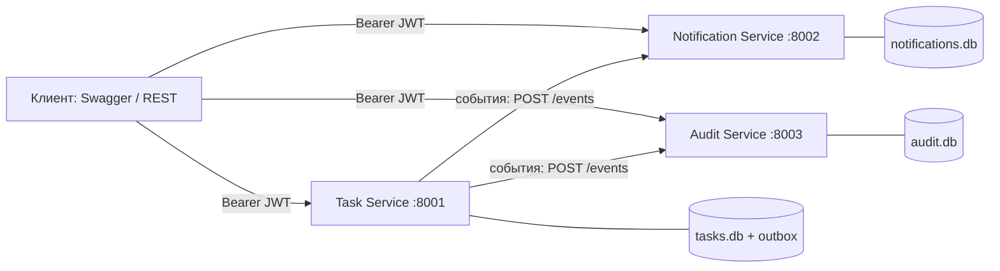
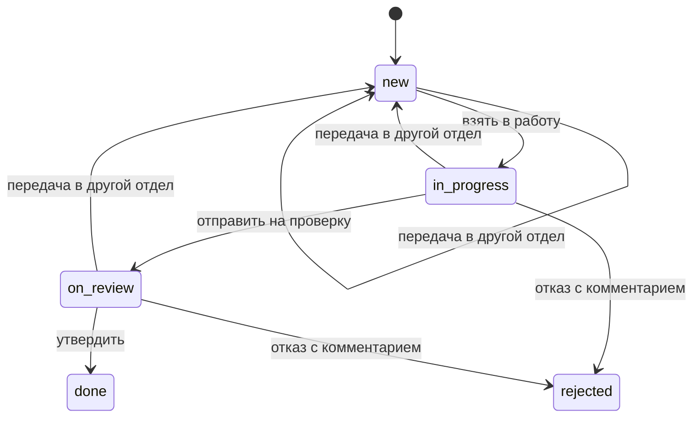

# Отчёт о реализации и проверке системы межотдельских задач банка

**Работа № 6. Система управления задачами между отделами банка**

## 1. Цель и назначение системы

Разработана система для постановки и исполнения задач между подразделениями банка, обеспечивающая централизованное управление статусами, разграничение прав сотрудников, формирование уведомлений и регистрацию истории изменений.

Функциональность разделена на три независимых HTTP-микросервиса: Task Service, Notification Service и Audit Service. Сервисы запускаются через Docker Compose, имеют отдельные Dockerfile, порты, хранилища и проверки работоспособности. Справочник отделов и сотрудников и выдача JWT реализованы в Task Service.

## 2. Архитектура

| Сервис | Порт | Назначение | Хранилище |
|---|---:|---|---|
| Task Service | 8001 | Аутентификация, отделы, сотрудники, задачи, комментарии, жизненный цикл, очередь событий | `tasks.db` на `task_data` |
| Notification Service | 8002 | Приём событий, уведомления отделам и сотрудникам, отметки о прочтении | `notifications.db` на `notification_data` |
| Audit Service | 8003 | История действий с состояниями до и после изменения | `audit.db` на `audit_data` |



Взаимодействие сервисов выполняется по HTTP/JSON внутри сети `bank_net`. Прямой доступ одного сервиса к базе другого отсутствует. Для внутренних запросов `POST /events` используется заголовок `X-Service-Token`.

Код каждого сервиса организован по слоям `api`, `services`, `repositories` и `schemas`. Общие функции JWT, SQLite и контракты событий находятся в каталоге `common/`.

### 2.1. Хранение данных

Каждый сервис хранит данные в отдельной SQLite-базе на именованном Docker volume. Транзакция изменения задачи в Task Service также сохраняет записи для отправки события двум получателям в `outbox`. Таким образом, сбой сети после сохранения задачи не уничтожает информацию о необходимости доставки уведомления и записи аудита.

В Notification и Audit события дедуплицируются по `event_id`. Записи журнала Audit Service не имеют API для изменения и удаления; SQLite-триггеры дополнительно запрещают `UPDATE` и `DELETE`.

### 2.2. Конфигурация и запуск

Настройки заданы в локальном файле `.env`, образец — [`.env.example`](.env.example). `.env` исключён из Git. Через переменные окружения задаются внешние порты, адреса межсервисных вызовов, пути SQLite, ключи авторизации и интервалы повторной отправки.

Запуск из каталога `Python/Homework_6`:

```powershell
Copy-Item .env.example .env  # только при первом развёртывании
# В .env задаются собственные JWT_SECRET, SERVICE_API_KEY
# и BOOTSTRAP_ADMIN_PASSWORD
docker compose config --quiet
docker compose up --build -d
docker compose ps
```

Для каждого сервиса доступен `GET /health`, а документация REST API формируется автоматически по OpenAPI:

| Сервис | Swagger | Проверка состояния |
|---|---|---|
| Task | http://localhost:8001/docs | http://localhost:8001/health |
| Notification | http://localhost:8002/docs | http://localhost:8002/health |
| Audit | http://localhost:8003/docs | http://localhost:8003/health |

При запуске все три контейнера достигли состояния `healthy`. Запросы к трём `/health` вернули `status: ok` с соответствующими значениями `service`: `task`, `notification`, `audit`.

Остановка `docker compose down` не удаляет именованные тома; их удаление отдельным параметром `-v` приводит к потере сохраняемых данных.

## 3. Аутентификация и справочники

Авторизация пользователей выполняется по логину и паролю через `POST /auth/login-json` либо `POST /auth/login` с выдачей JWT Bearer. Полученный токен применяется в заголовке `Authorization` защищённых эндпоинтов. Пароли хранятся в виде PBKDF2-HMAC-SHA256 с солью. Различаются роли `admin`, `manager`, `employee`.

Начальное наполнение справочника: `CREDIT`, `COMPLIANCE`, `OPERATIONS` и `IT`.

В ходе проверки созданы и просмотрены следующие учётные записи:

| ID | Логин | Отдел | Роль |
|---:|---|---|---|
| 1 | `admin` | IT (ID 4) | `admin` |
| 2 | `credit_manager` | CREDIT (ID 1) | `manager` |
| 3 | `compliance_worker` | COMPLIANCE (ID 2) | `employee` |

`POST /employees` вернул HTTP **201** при создании каждого сотрудника, а `GET /employees` — HTTP **200** со всеми тремя записями. Успешный запрос `POST /auth/login-json` вернул HTTP **200** и JWT. Действие `GET /departments` вернуло HTTP **200** и четыре отдела.

## 4. Управление задачами

Поддерживаются создание, получение, изменение, фильтрация задач по статусу, приоритету, отделу и исполнителю, назначение сотрудника, комментарии, перевод статусов, передача между отделами и контроль сроков.

Допустимые приоритеты: `low`, `medium`, `high`, `critical`.

### 4.1. Жизненный цикл



Некорректные переходы отклоняются с HTTP **409**. Отказ `rejected` требует непустого комментария, иначе возвращается HTTP **422**. При передаче в другой отдел статус сбрасывается в `new`, текущий исполнитель снимается.

### 4.2. Фактические испытания

| Задача | Действие | Результат |
|---|---|---|
| № 1 «Проверить кредитную заявку» | Создание администратором для COMPLIANCE | HTTP **201**, `new`, приоритет `high` |
| № 1 | Принятие в работу сотрудником `compliance_worker` (ID 3) | HTTP **200**, `in_progress`, `assignee_id: 3` |
| № 1 | Передача результата на проверку | HTTP **200**, `on_review` |
| № 1 | Завершение автором `admin` | HTTP **200**, `done`, `version: 4` |
| № 1 | Контрольное чтение `GET /tasks/1` | HTTP **200**, сохранён статус `done` |
| № 2 «Проверить подозрительную операцию» | Создание и принятие в работу | HTTP **201**, затем **200**, `in_progress` |
| № 2 | Попытка отклонения без комментария | HTTP **422**, `Rejection requires a comment` |
| № 2 | Отклонение с комментарием | HTTP **200**, `rejected`, `version: 3` |
| № 3 «Согласовать условия кредитования» | Создание для COMPLIANCE | HTTP **201**, `new` |
| № 3 | Передача в CREDIT | HTTP **200**, `assignee_department_id: 1`, `assignee_id: null`, `new` |
| № 3 | Контрольное чтение `GET /tasks/3` | HTTP **200**, `version: 2` и новый отдел подтверждены |

Для задачи № 1 `GET /notifications?department=2` вернул HTTP **200** с уведомлениями о переходах статусов, в том числе `in_progress → on_review` и `on_review → done`.

Запрос `GET /audit?task_id=1` вернул HTTP **200** и последовательность событий по задаче, включая автора операции, время, `old_value` и `new_value`. Таким образом, сохранены и бизнес-данные, и история их изменения.

## 5. Проверка отказоустойчивости

Task Service использует паттерн **Transactional Outbox**. При сохранении задачи формируются независимые записи для Notification и Audit. В каждой записи присутствуют `event_id`, `destination`, `attempts`, `last_error` и `delivered_at`. Повторная отправка выполняется фоновым обработчиком либо по административному запросу `POST /outbox/retry`.

### 5.1. Отказ Notification Service — 25 ноября 2026 года

Проведён эксперимент с остановкой контейнера:

```powershell
docker compose stop notification
docker compose ps
```

Во время остановки `notification` сервисы `task` и `audit` оставались `healthy`. Выполнено создание задачи **№ 4** «Проверить документы нового клиента»; `POST /tasks` вернул HTTP **201** и `status: new`.

Состояние Outbox для события задачи № 4:

| Параметр | Пока Notification недоступен | После восстановления |
|---|---|---|
| Запись | № 19 | № 19 |
| `event_id` | `32b6b2d5-fb55-4ce2-9bff-7ae3b4f43df1` | тот же |
| `destination` | `notification` | `notification` |
| `attempts` | **3** | **8** |
| `last_error` | `[Errno -5] No address associated with hostname` | `null` |
| `delivered_at` | `null` | `2026-11-25T10:21:11+00:00` |

Для того же `event_id` запись № 20, адресованная `audit`, была доставлена независимо, с одной попытки.

После `docker compose start notification` контейнер восстановил состояние `healthy`, а очередь обеспечила последующую доставку накопленного события. Это подтверждает сохранение операции создания задачи при отсутствии сервиса уведомлений.

### 5.2. Отказ Audit Service — 26 ноября 2026 года

Проведена остановка сервиса аудита:

```powershell
docker compose stop audit
docker compose ps
```

Во время отказа `audit` два других сервиса продолжили работу в состоянии `healthy`. Создана задача **№ 5** «Проверить банковскую транзакцию» с приоритетом `critical`; `POST /tasks` вернул HTTP **201**.

Состояние двух записей одного события:

| Outbox ID | Получатель | Результат при недоступном Audit |
|---:|---|---|
| 21 | `notification` | Доставлено с **1-й попытки**, `delivered_at: 2026-11-26T12:42:02+00:00` |
| 22 | `audit` | **3 попытки**, сетевая ошибка, `delivered_at: null` |

После `docker compose start audit` контейнер стал `healthy`. При следующем чтении Outbox у записи № 22 зафиксировано:

```json
{
  "id": 22,
  "destination": "audit",
  "attempts": 5,
  "last_error": null,
  "delivered_at": "2026-11-26T12:43:13+00:00"
}
```

Административный запрос `POST /outbox/retry` вернул HTTP **200** с `delivered: 0`, `failed: 0` и `busy: false`: к моменту его выполнения фоновой обработчик уже завершил доставку.

Заключительный `GET /audit?task_id=5` вернул HTTP **200** и запись `task_created` с `task_id: 5`, `actor: 1`, `old_value: null` и новым состоянием задачи в `new_value`.

Таким образом, при отказе Audit Service задача и уведомление сохраняются, событие аудита остаётся в Outbox и регистрируется в журнале после восстановления.

### 5.3. Итог экспериментов

| Критерий | Отказ Notification | Отказ Audit |
|---|---|---|
| Task Service сохранил работоспособность | Да | Да |
| Создание задачи завершилось HTTP 201 | Да, № 4 | Да, № 5 |
| Доставка во второй вспомогательный сервис | Да, в Audit | Да, в Notification |
| Событие для недоступного сервиса осталось в Outbox | Да | Да |
| После восстановления событие доставлено | Да | Да |
| Данные подтверждены целевым API | Проверена доставка Outbox; уведомления по задаче можно получить через `GET /notifications` | Да, `GET /audit?task_id=5` |

## 6. Автоматическое тестирование

Испытания проводились на Windows из каталога `Python/Homework_6`. Запуск:

```powershell
.\.venv\Scripts\python.exe -m pytest -v
```

Зафиксированная среда: **Windows (win32)**, **Python 3.14.7**, **pytest 9.2.0**, **pluggy 1.7.0**.

**Фактический результат: 27 passed, 1 warning.** Все 27 тестов завершились успешно; одно предупреждение тестового запуска зафиксировано отдельно, его тип на представленном снимке не раскрыт.

Проверяемые группы сценариев:

- Аутентификация, права ролей и активность сотрудников.
- Создание, изменение и фильтрация задач; назначение исполнителя.
- Жизненный цикл `new → in_progress → on_review → done`.
- Отклонение с комментарием, передача между отделами, ограничения закрытых задач.
- Уведомления: идемпотентность, прочтение, доступ по отделам.
- Аудит: идемпотентность, доступ по ролям, запрет изменения/удаления записей.
- Повторная доставка Outbox после отказа Notification и Audit.
- Раздельные SQLite-базы, HTTP API и `/health`.
- Контроль приближающихся сроков и отсутствие дублирующих событий.

После тестирования выполнено `docker compose ps`: **все три сервиса имели статус `Up (healthy)`** и были доступны на портах 8001, 8002 и 8003.

## 7. Результаты

Реализован и проверен backend из трёх HTTP-микросервисов с независимыми хранилищами, ролевой авторизацией, жизненным циклом задач, уведомлениями и журналом изменений.

Функциональные испытания подтвердили создание и завершение задач, контроль недопустимых операций, обязательность комментария при отклонении и передачу задачи в другое подразделение. Оба эксперимента по остановке вспомогательных сервисов показали, что Task Service продолжает выполнять операции, а отложенные события доставляются после восстановления получателя.

Выполнены **27 автоматических тестов без неуспешных проверок**; система завершила испытания с тремя контейнерами в состоянии `healthy`.

## Приложение А. Воспроизведение проверок

### Запуск

```powershell
cd Python\Homework_6
docker compose up --build -d
docker compose ps
Invoke-RestMethod http://localhost:8001/health
Invoke-RestMethod http://localhost:8002/health
Invoke-RestMethod http://localhost:8003/health
```

### Проверка отказов

```powershell
docker compose stop notification
# POST /tasks; GET /outbox (через Swagger Task Service)
docker compose start notification
# GET /outbox; GET /notifications

docker compose stop audit
# POST /tasks; GET /outbox
docker compose start audit
# GET /outbox; GET /audit?task_id=<ID созданной задачи>
```

### Проверка тестов и завершение

```powershell
.\.venv\Scripts\python.exe -m pytest -v
docker compose ps
docker compose down
```

Команда `docker compose down` используется без `-v` для сохранения именованных томов.

## Приложение Б. Исходные материалы

- [Исходный код, конфигурация и руководство по запуску](README.md)
- [Архитектура, контракты и ограничения](docs/architecture.md)
- [HTTP-примеры](examples/requests.http)
- [Автоматические тесты](tests/)
- [Конфигурация Docker Compose](docker-compose.yml)

Результаты интерактивной проверки зафиксированы в снимках Swagger UI и консоли Docker/pytest, включая HTTP-ответы, результаты остановки и восстановления контейнеров и состояния очереди Outbox.
