# ДЗ-6. Система доставки «По району» — отчёт о запуске, работе и отказах сервисов

Отчёт описывает архитектуру системы доставки «По району», запуск компонентов Docker Compose и наблюдаемое поведение главного интерфейса при остановке и восстановлении сервисов `navigation` и `orders`. Результаты зафиксированы скриншотами Windows PowerShell и браузера.

## 1. Назначение системы

Реализовать систему из функционально связанных сервисов, выделив главный сервис и вспомогательные. Подтвердить работу при нормальной связи, способность главного сервиса обнаруживать отказ вспомогательного компонента и возобновлять работу после его восстановления.

Предметная область проекта — небольшая служба доставки: клиент оформляет заказ в Telegram Mini App, курьер видит заказ и маршруты в браузере.

## 2. Компоненты и архитектура

| Контейнер | Назначение | Как взаимодействует |
|---|---|---|
| `main` | **Главный сервис**: интерфейс курьера на `http://localhost:8080` | HTTP-запросы к `orders` и `navigation` |
| `orders` | Хранение заказов и контроль стадий | SQLite в постоянном Docker-томе `order_data` |
| `navigation` | Поиск пешеходного маршрута | Граф улиц из Overpass / OSM, алгоритм Дейкстры; том `street_data` |
| `miniapp` | Интерфейс клиента; проверка `initData` Telegram | Создаёт заказы в `orders` |
| `tunnel` | Внешний HTTPS-доступ Telegram к `miniapp` | Cloudflare Quick Tunnel |

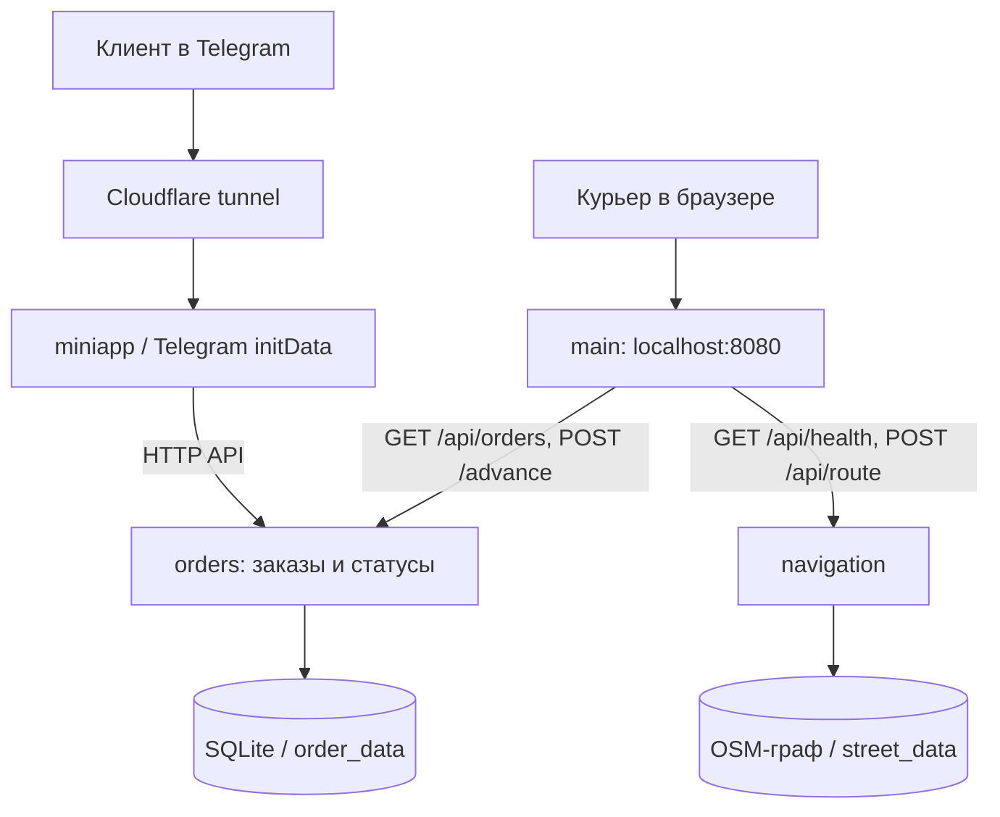

Сервисы работают в сети Docker Compose, обращаются друг к другу по DNS-именам `orders` и `navigation`. Главный интерфейс периодически обновляет данные. При ошибках связи браузер показывает предупреждение, сохраняя последнюю загруженную карточку заказа в рамках открытой вкладки. Это **наблюдаемость отказа и ограниченная деградация функции**, а не полная независимость от любого сбоя.

## 3. Запуск в Windows

Требуются Docker Desktop с Compose, Telegram Desktop, браузер и интернет для Cloudflare Tunnel и картографических ресурсов.

Команды из каталога `Python/Homework_6` в PowerShell:

```powershell
Copy-Item .env.example .env
# Параметр BOT_TOKEN задаётся в локальном файле .env
docker compose up --build -d
docker compose ps
docker compose logs --tail=50 tunnel
```

Токен хранится локально в `.env` и не включается в репозиторий. В логах `tunnel` появляется временный HTTPS-адрес `https://...trycloudflare.com`; после нового запуска туннеля он может измениться. Для кнопки клиента в `@BotFather` выполнить `/setmenubutton`, выбрать бота, отправить адрес и задать текст «Сделать заказ». Открыть чат бота в Telegram, нажать кнопку. Курьеру открыть **`http://localhost:8080`**.

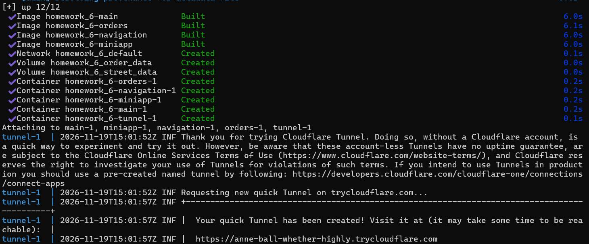

*Рисунок 1 — запуск контейнеров `main`, `orders`, `navigation`, `miniapp`, `tunnel` и успешное создание HTTPS-туннеля.*

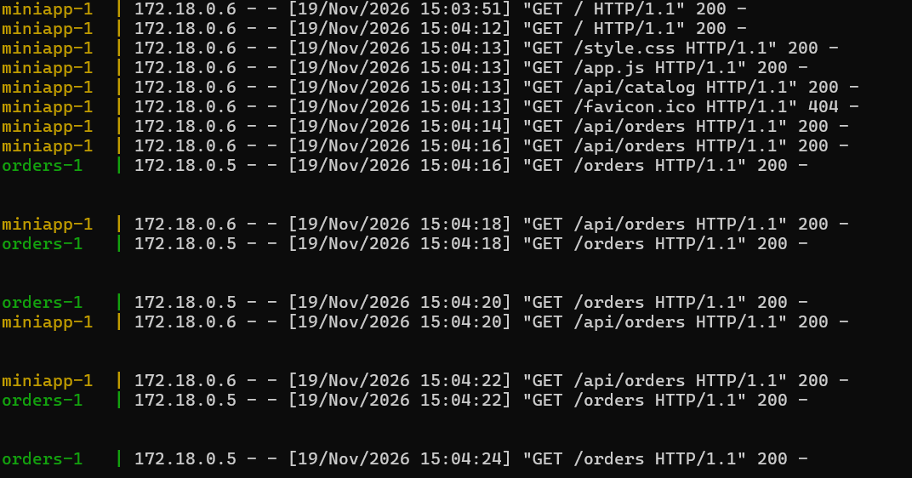

*Рисунок 2 — ответы HTTP 200 от Mini App и `orders`, подтверждающие связь компонентов.*

## 4. Нормальная работа системы

До создания заказа интерфейс курьера показывает карту Тверского района и сообщение об ожидании заказа.

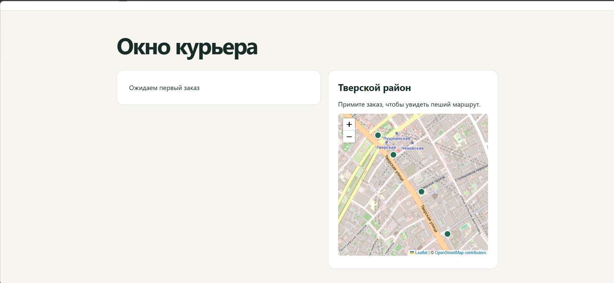

*Рисунок 3 — главный сервис запущен и доступен в браузере.*

Клиент через Telegram выбирает ресторан, блюдо, количество, место доставки и оформляет заказ. В демонстрации создан **заказ № 1** в ресторане «Кухня у театра»: **два куриных супа за 540 ₽**, получение у памятника Чехову, доставка к Елисеевскому. В клиентском окне виден текст «Заказ №1 оформлен», а в курьерском — новая карточка и кнопка «Принять заказ».

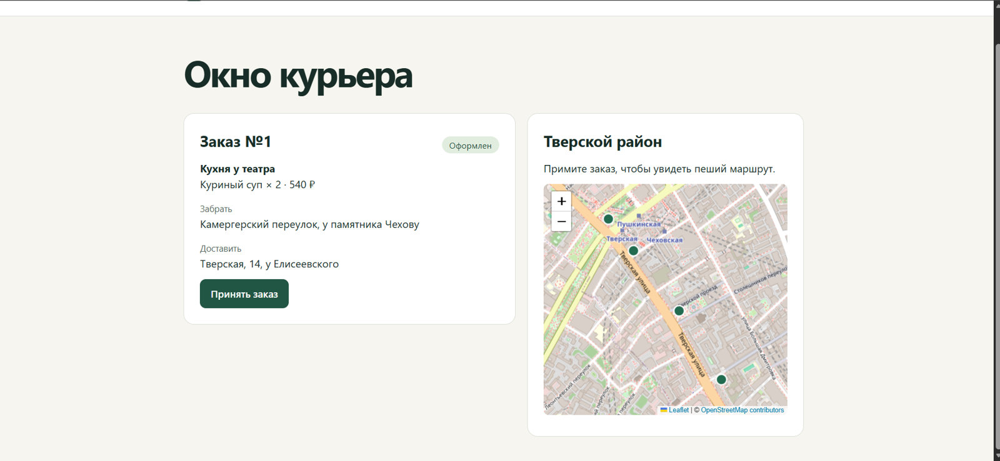

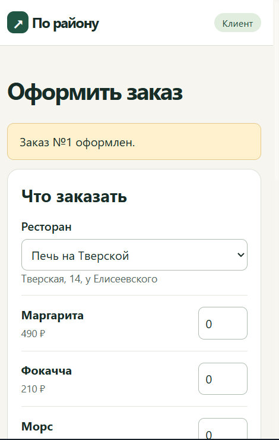

*Рисунки 4–5 — один и тот же заказ в клиентском и курьерском интерфейсах.*

После нажатия **«Принять заказ»** стадия меняется на «Курьер идёт в ресторан». Навигация строит пешеходный путь от Пушкинской площади к Камергерскому переулку; в демонстрации длина **813 м**.

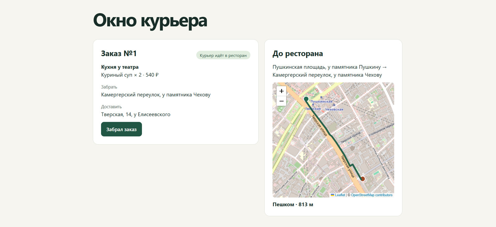

*Рисунок 6 — реальная карта OpenStreetMap, линия пешеходного маршрута и расстояние.*

## 5. Проверка отказа вспомогательного сервиса navigation

Команда остановки:

```powershell
docker compose stop navigation
```

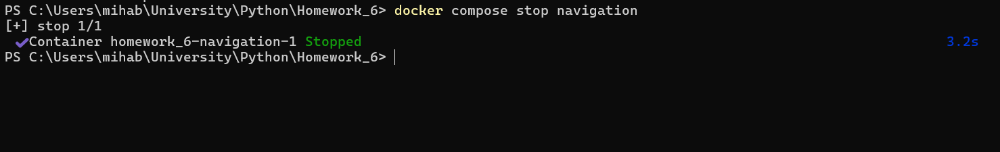

После остановки главный интерфейс **остаётся доступным**. Он показывает предупреждение «Навигация временно недоступна. Адреса указаны в карточке заказа». Заказ, адреса и кнопка смены стадии остаются, но линия маршрута и метры исчезают. Это подтверждает, что отсутствие маршрутизации отображается именно в главном сервисе.

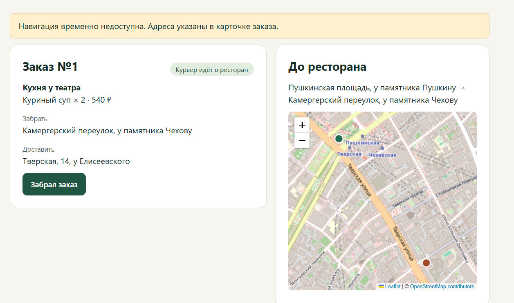

*Рисунки 7–8 — эксперимент с отказом `navigation` и видимой деградацией работы главного сервиса.*

Затем:

```powershell
docker compose start navigation
```

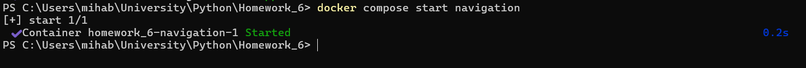

На следующем этапе доставки после «Забрал заказ» появляется маршрут **до клиента**, в демонстрации **672 м**. Работа `navigation` возобновлена без перезапуска `main`.

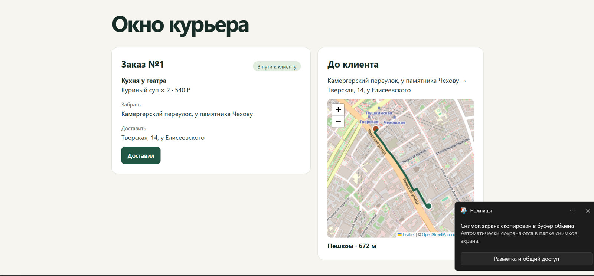

*Рисунки 9–10 — возврат сервиса и восстановление маршрутизации.*

## 6. Проверка отказа вспомогательного сервиса orders

Когда заказ находится в состоянии «В пути к клиенту», выполнить:

```powershell
docker compose stop orders
```

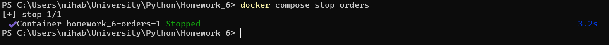

Главный интерфейс отображает предупреждение «Сервис заказов недоступен. Показаны последние полученные данные». Последняя карточка и ранее рассчитанный маршрут остаются видны, но кнопка «Доставил» становится неактивной, так как изменение статуса требует `orders`.

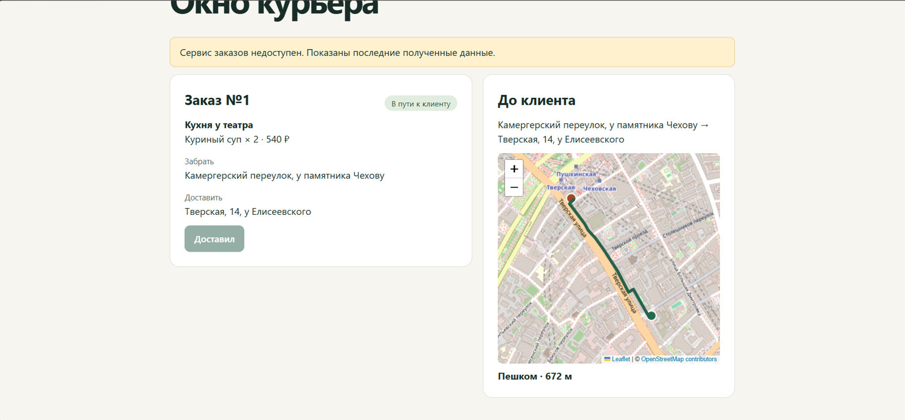

*Рисунки 11–12 — отключение сервиса заказов и запрет некорректного действия в главном интерфейсе.*

Запустить сервис обратно:

```powershell
docker compose start orders
```

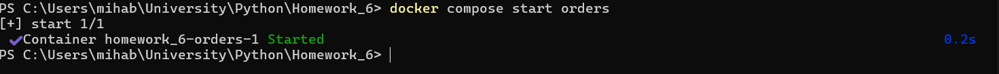

После восстановления подключение возобновляется, предупреждение исчезает и кнопка «Доставил» снова активна. После восстановления связи предупреждение исчезает и становится доступна кнопка «Доставил».

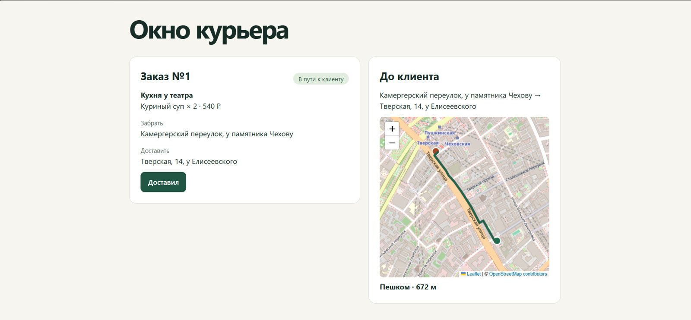

*Рисунки 13–14 — восстановление `orders` без перезапуска основного сервиса.*

## 7. Техническая реализация обработки ошибок

Главный обработчик `main.py` передаёт HTTP-запросы через общую функцию `Frontend.forward()`. При невозможности подключиться к вспомогательному сервису формируется ответ **HTTP 503** с сообщением о потере связи. Клиентский JavaScript (`web/app.js`) различает неработающий `orders` и `navigation`: выводит разные предупреждения, отключает операции с заказом при отсутствии данных и очищает неактуальную линию маршрута. Заказы хранятся в SQLite, а текущие результаты отображения в браузере обновляются периодически.

Построение маршрута в `navigation.py` происходит по пешеходному графу OSM методом поиска кратчайшего пути. При первом старте граф загружается из Overpass, поэтому до его подготовки возможен временный `503`. После загрузки сеть улиц хранится в Docker-томе.

```mermaid
sequenceDiagram
    actor Tester as Проверяющий
    participant Docker as Docker Compose
    participant Main as Главный интерфейс
    participant Orders as orders
    participant Nav as navigation
    Tester->>Docker: stop navigation
    Main->>Nav: POST /route
    Nav--xMain: Сервис недоступен
    Main-->>Tester: Предупреждение, нет маршрута; заказ виден
    Tester->>Docker: start navigation
    Nav-->>Main: Маршрут снова доступен
    Tester->>Docker: stop orders
    Main->>Orders: GET /orders
    Orders--xMain: Сервис недоступен
    Main-->>Tester: Предупреждение, действия заблокированы
    Tester->>Docker: start orders
    Orders-->>Main: Заказы и статусы вновь доступны
```

## 8. Результаты проверки взаимодействия сервисов

| Проверяемое свойство | Наблюдаемый результат |
|---|---|
| Несколько функционально связанных сервисов | Пять Docker-контейнеров; схема архитектуры; рис. 1–2 |
| Выделен главный сервис | `main`, браузер курьера `localhost:8080`; рис. 3–4 |
| Связь с вспомогательными | `orders` и `navigation`; рис. 4–6 |
| Отказ вспомогательного заметен в главном | `stop navigation` / предупреждение, рис. 7–8; `stop orders` / блокировка действий, рис. 11–12 |
| Сервисы восстанавливаются | `start navigation`, рис. 9–10; `start orders`, рис. 13–14 |

В ходе испытаний контейнеры `navigation` и `orders` последовательно останавливались и запускались без перезапуска `main`. Остановка окружения без удаления томов выполняется командой `docker compose down`; тома `order_data` и `street_data` сохраняют данные.

## 9. Вывод

Разработано приложение доставки с одним главным и несколькими вспомогательными сервисами, объединёнными HTTP API и Docker Compose. Два реальных испытания показали, что при остановке `navigation` и `orders` главный интерфейс продолжает открываться и **сообщает, какой сервис недоступен**; при этом недоступная функция отключается, а другая информация остаётся доступной. После повторного запуска компонента связь восстанавливается без перезапуска главного сервиса. В ходе испытаний подтверждены отображение отказов вспомогательных сервисов в главном интерфейсе и автоматическое восстановление взаимодействия после повторного запуска контейнеров.