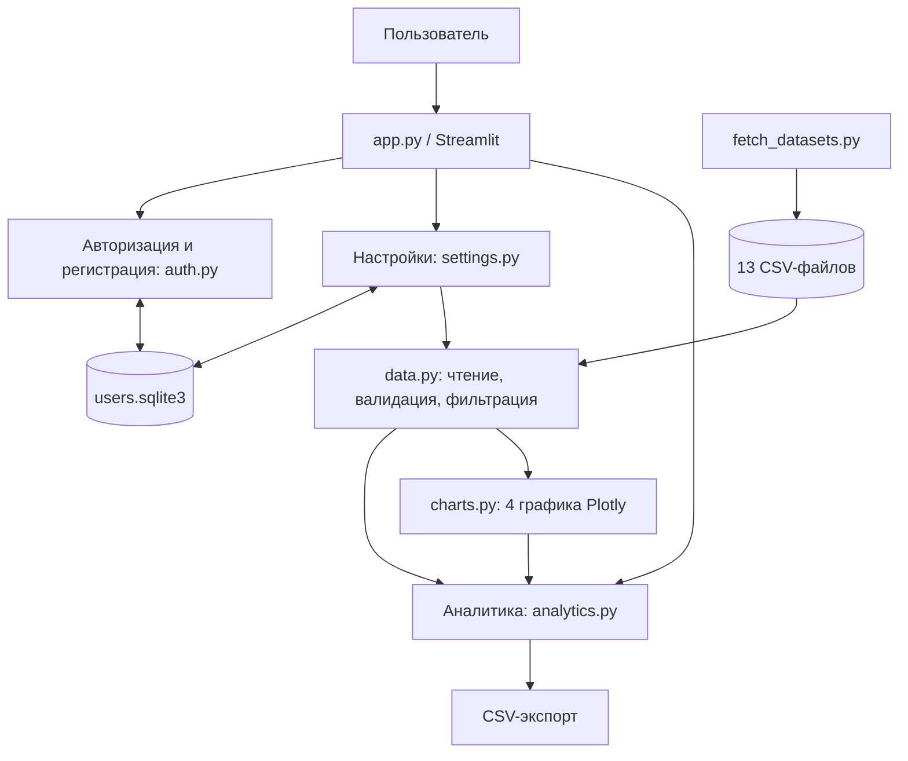
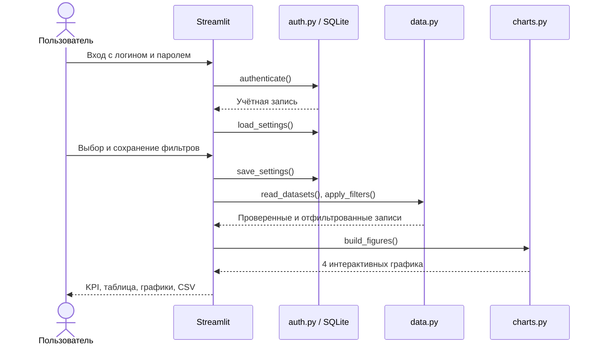

# РК-2 — анализ CVE-инцидентов в Streamlit

Многопользовательское веб-приложение для анализа учебного набора записей об уязвимостях CVE за 2014–2026 годы. Реализованы регистрация и вход, индивидуальные настройки фильтрации, таблица, KPI, интерактивные графики и экспорт результатов.

## Запуск на macOS

Из каталога `Python/rk_2` выполните:

```bash
python3 -m venv .venv
source .venv/bin/activate
python -m pip install -r requirements.txt
python fetch_datasets.py
python -m streamlit run app.py
```

Приложение открывается по адресу `http://localhost:8501`; для остановки используйте `Ctrl+C`. Python — версии 3.10 или новее. Для первоначального скачивания CSV требуется интернет; после загрузки возможна работа без сети.

## Архитектура

`app.py` является точкой входа и управляет маршрутизацией между страницами. В `auth.py` находятся учётные записи и настройки пользователя в SQLite. `settings.py` отвечает за форму фильтрации; `data.py` — за загрузку и проверку CSV, фильтрацию и KPI; `charts.py` строит графики Plotly; `analytics.py` отображает таблицу и визуализации. Модули анализа отделены от интерфейса, поэтому расчёты можно проверять независимо от Streamlit.



## Логика работы приложения

1. Незарегистрированный посетитель видит только формы входа и регистрации. Пароли не сохраняются в открытом виде: используется PBKDF2-HMAC-SHA256 со случайной солью.
2. После входа пользователь переходит на аналитическую страницу. Доступ к защищённым разделам проверяется через `st.session_state`.
3. В настройках можно выбрать годы, типы атак, критичность, векторы атаки, отрасли, страны, минимальный CVSS, наличие эксплойта и статус эксплуатации. Настройки хранятся в SQLite отдельно для каждого пользователя.
4. `data.py` считывает выбранные годы, проверяет поля, даты, числовые значения и идентификаторы CVE; ошибочные записи не должны приводить к падению всей страницы. Загрузка кэшируется с помощью `st.cache_data`.
5. После фильтрации отображаются KPI, четыре графика, таблица с поиском и возможность скачать CSV. Если выборка пуста, выводится понятное сообщение.



## Аналитические возможности

| Элемент | Содержание |
|---|---|
| KPI | Общее число записей, средний CVSS, число Critical, сумма затронутых узлов |
| Динамика | Число записей по годам |
| Типы атак | Распределение по `attack_type` |
| Топ-10 | Производители с наибольшим числом записей |
| Тепловая карта | Частота сочетаний `attack_type` и `target_sector` |
| Таблица | Просмотр, поиск по CVE ID/вендору/продукту, сортировка |
| Экспорт | Скачивание текущей выборки в CSV |

## Источники данных

Скрипт `fetch_datasets.py` скачивает 13 файлов `cyberattacks_cve_YYYY.csv` в каталог `cve_datasets/`. `source_reference.py` содержит контрольные суммы проверенной версии данных: 15 847 записей, 19 полей, годы 2014–2026. Если преподаватель обновит CSV, контрольные суммы потребуется пересмотреть. Исходные данные учебные и не заменяют официальную статистику NVD.

## Проверка работоспособности

Запустите приложение и последовательно проверьте: регистрацию двух пользователей, вход и выход, независимость их настроек, изменение фильтров, появление всех четырёх графиков, поиск и скачивание CSV, пустую выборку и сохранение настроек после перезапуска. При удалении одного CSV приложение должно предупредить об отсутствии файла, а не аварийно завершиться. Локальная база `users.sqlite3` и скачанные датасеты не должны публиковаться в GitHub.

В репозитории находятся только файлы, необходимые для запуска, и этот README. Автоматические тесты и отдельные материалы проверки в опубликованный каталог не входят.
