# РК-2. CVE Analytics — отчёт о запуске и проверке веб-приложения Streamlit

> **Предмет работы:** многопользовательская система анализа учебных CVE-инцидентов за 2014–2026 годы. Скриншоты ниже получены при реальном запуске на Windows и демонстрируют загрузку данных, авторизацию, визуализации, фильтрацию и автоматические тесты.

## 1. Постановка задачи

Реализовать на Python и Streamlit приложение с тремя функциональными страницами: регистрация/авторизация, настройки анализа, главная аналитическая страница. Требуются безопасное хранение паролей, персональные настройки, загрузка 13 CSV, фильтрация, четыре KPI, минимум четыре визуализации, таблица с поиском и экспортом, обработка отсутствующих или ошибочных данных.

## 2. Структура проекта

```text
rk_2/
├── app.py                 # точка входа и маршрутизация Streamlit
├── auth.py                # SQLite, регистрация, проверка паролей
├── settings.py            # пользовательские фильтры
├── data.py                # загрузка, проверка CSV, фильтрация и KPI
├── analytics.py           # главная страница, таблица, экспорт
├── charts.py              # четыре графика Plotly
├── fetch_datasets.py      # скачивание исходных CSV
├── source_reference.py    # проверочные суммы исходных файлов
├── cve_datasets/          # 13 годовых CSV (2014–2026)
├── tests/                 # логические и Streamlit AppTest-тесты
├── requirements.txt
└── README.md
```

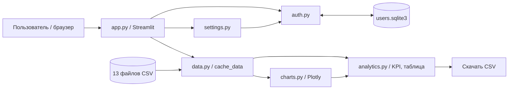

Учётные записи и сохранённые фильтры хранятся в SQLite отдельно для каждого пользователя. Пароль проверяется по хешу PBKDF2-HMAC-SHA256 со случайной солью. Разделы аналитики и настроек доступны только после успешной авторизации через `st.session_state`. Данные читаются pandas, проверяются и кэшируются `st.cache_data`; фильтрация выполняется по выбранным параметрам до расчёта KPI и графиков.

## 3. Подготовка и запуск на Windows

Перейти в папку `Python/rk_2` в PowerShell:

```powershell
py --version
py -m venv .venv
Set-ExecutionPolicy -Scope Process -ExecutionPolicy Bypass
.\.venv\Scripts\Activate.ps1
python -m pip install -r requirements.txt pytest
python scripts_check.py --strict --check-reference
python -m pytest -v
python -m streamlit run app.py
```

При отсутствии файлов в `cve_datasets` сначала выполнить `python fetch_datasets.py`. После запуска открыть **http://localhost:8501**. Команда `Set-ExecutionPolicy` здесь меняет разрешение только для текущего окна PowerShell. Остановить сервер можно сочетанием `Ctrl+C`.

## 4. Проверка оригинальных данных

Скрипт `scripts_check.py --strict --check-reference` сверяет данные всех 13 годов с контрольным манифестом, проверяет число строк и возможность построения расчётов. По скриншоту проверены **15 847 записей**, годы **2014–2026** и **четыре вида графиков** (`trend`, `attacks`, `vendors`, `heatmap`). Получены KPI для всей выборки: средний CVSS **4,98**, Critical **1 580**, затронутых узлов **396 999 474**. Итог: **`OK`**.

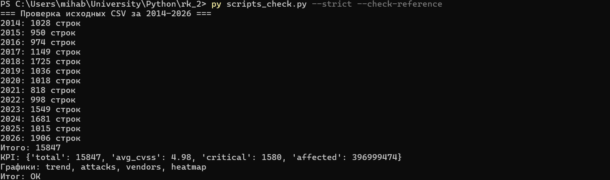

*Рисунок 1 — проверены 13 исходных файлов и корректность данных.*

## 5. Автоматические тесты

Выполнено `python -m pytest -v`: **24 passed in 6.80s**, без пропущенных UI-тестов. Проверяются регистрация, вход, индивидуальные настройки, обработка неверных CSV и дублей, контрольные суммы, стабильность загрузки, графики и сценарии Streamlit `AppTest`.

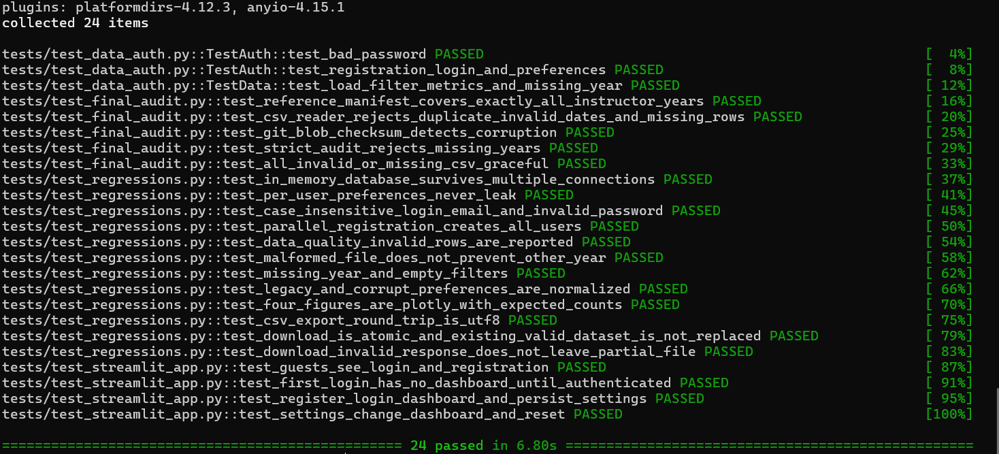

*Рисунок 2 — все 24 автоматических теста, включая Streamlit UI, завершились успешно.*

## 6. Регистрация и авторизация

При первом открытии приложение показывает две вкладки «Вход» и «Регистрация». Без авторизации невозможно переключиться на защищённые страницы. Для создания учётной записи нужно указать логин, email, пароль длиной от 8 символов и повтор пароля; после этого войти под созданным пользователем.

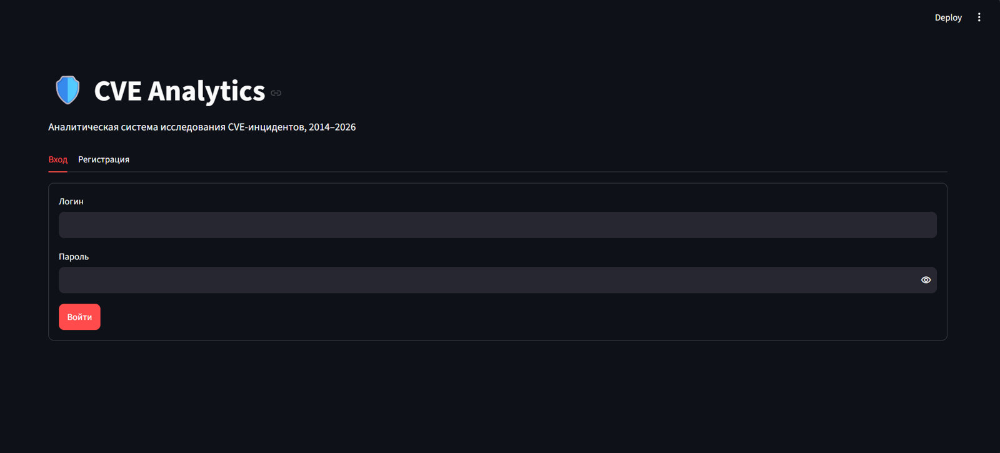

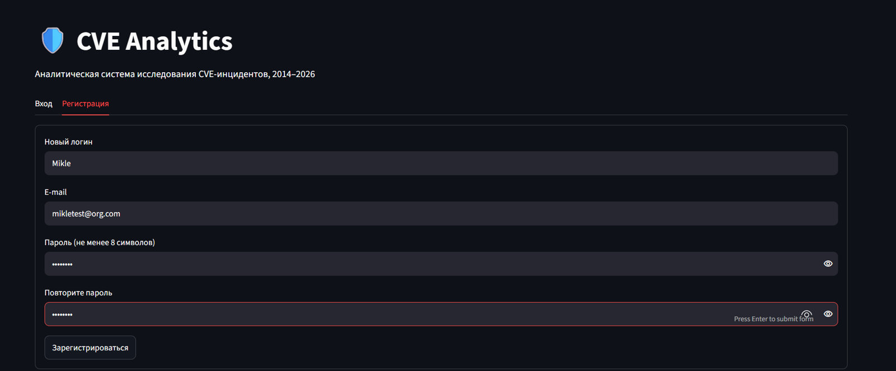

*Рисунки 3–4 — пользовательские формы. На втором снимке показано заполнение полей; пароль замаскирован.*

## 7. Основная аналитическая страница

После входа отображаются персональная навигация, активные фильтры и четыре KPI. При настройках по умолчанию на исходных данных получены **15 847 записей**, средний **CVSS 4,98**, **1 580 Critical**, **396 999 474** затронутых узла.

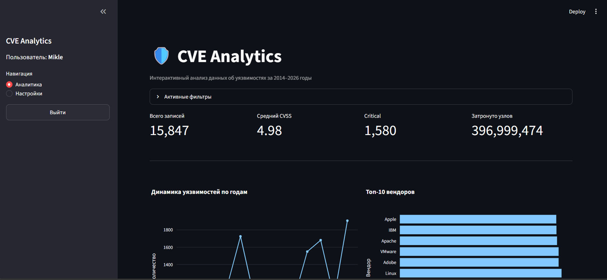

*Рисунок 5 — главная аналитическая страница с KPI всей выборки.*

Ниже находятся четыре интерактивных графика: динамика записей по годам (линейный), топ-10 вендоров (горизонтальная диаграмма), распределение по типам атак (столбцы), тепловая карта сочетания `attack_type` × `target_sector`. Интерактивность Plotly позволяет наводить курсор на элементы и узнавать конкретные значения.

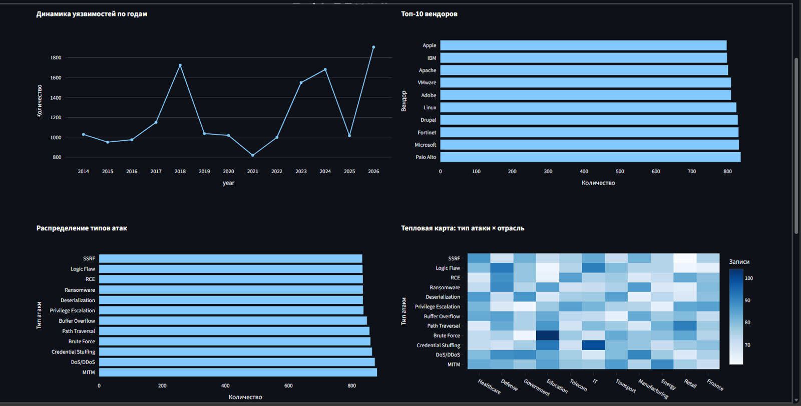

*Рисунок 6 — динамика, топ-10 вендоров, распределение типов атак и тепловая карта.*

В нижней части страницы расположена интерактивная таблица. Поле поиска работает по CVE ID, вендору и продукту; кнопка «Скачать отфильтрованные данные (CSV)» выгружает текущую таблицу в CSV UTF-8 с BOM, что удобно для Excel.

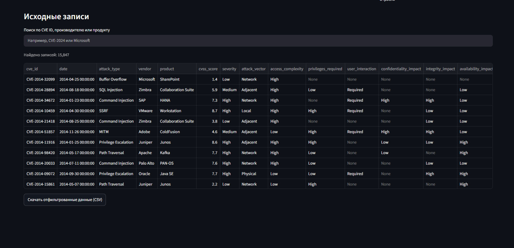

*Рисунок 7 — таблица исходных записей, поле поиска и кнопка скачивания.*

## 8. Настройки и применение фильтров

Страница «Настройки» позволяет выбрать годы, типы атак, критичность (`severity`), вектор атаки, страну, отрасль, минимальный CVSS, только записи с доступным эксплойтом и только эксплуатированные. Настройки сохраняются по пользователю в SQLite; кнопка сброса возвращает значения по умолчанию.

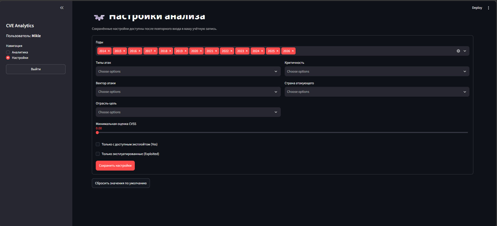

*Рисунок 8 — интерфейс всех доступных фильтров.*

В эксперименте часть годов снята с выбора, а минимальный CVSS увеличен до **7,20**. Приложение показало зелёное подтверждение «Настройки сохранены. Перейдите на страницу аналитики».

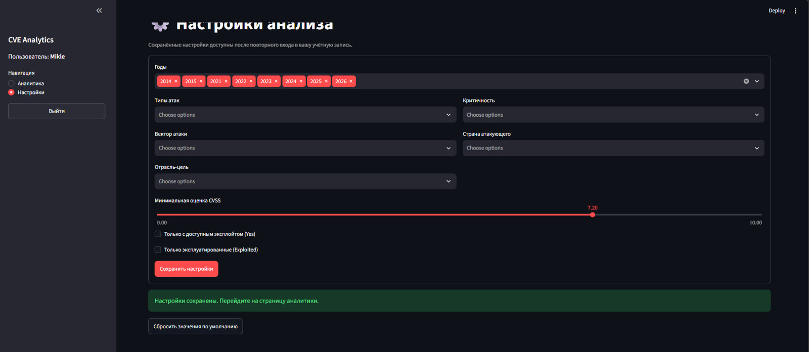

*Рисунок 9 — сохранение конфигурации анализа.*

После возвращения в аналитику выборка сократилась с **15 847 до 2 822** записей; средний CVSS вырос **с 4,98 до 8,58**; число Critical стало **1 006**, сумма затронутых узлов — **70 431 468**. Графики перестроились, а таблица стала содержать только записи после фильтрации.

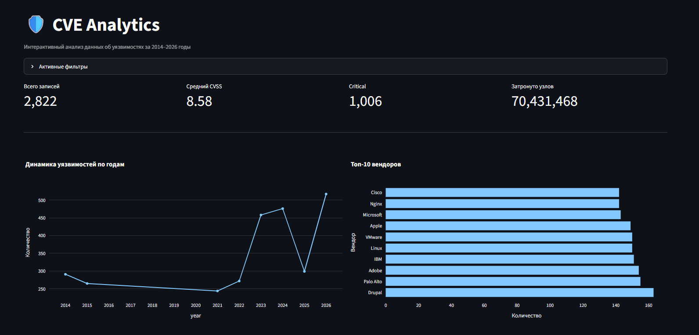

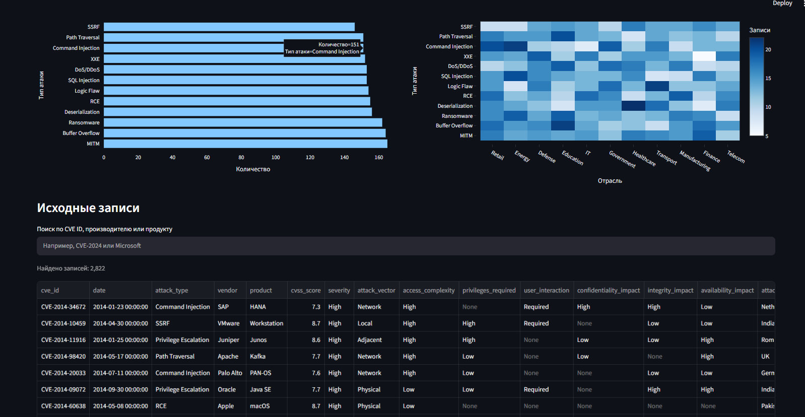

*Рисунки 10–11 — изменения всех аналитических представлений после сохранения фильтров.*

## 9. Как связаны пользовательские действия и расчёты

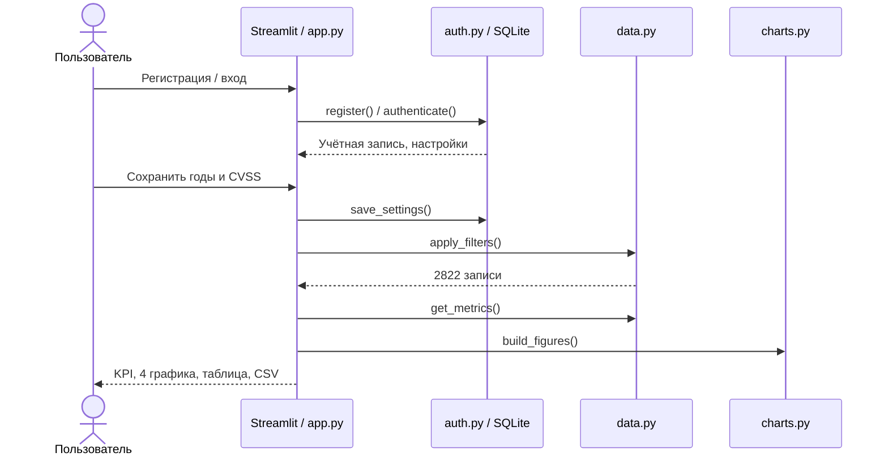

В `data.py` выполняются проверки структуры и значений CSV: корректность обязательных полей, года записи, идентификатора CVE, CVSS в диапазоне 0–10 и неотрицательного количества узлов. При неполной или некорректной выборке интерфейс должен выводить предупреждение вместо аварийного завершения. Эти случаи проверяются автоматическими тестами.

## 10. Матрица соответствия

| Требование преподавателя | Реализация / подтверждение |
|---|---|
| Регистрация и вход | `auth.py`, рис. 3–4; UI-тесты, рис. 2 |
| Проверка пароля и SQLite | `auth.py`, тесты в `tests/` |
| Запрет доступа гостям | `app.py`, Streamlit AppTest, рис. 2 |
| Настройки всех обязательных параметров | `settings.py`, рис. 8–9 |
| Сохранение пользовательских предпочтений | `auth.py`/SQLite, рис. 9; автоматические тесты |
| CSV за 2014–2026 годы | `cve_datasets/`, рис. 1 |
| Кэширование загрузки | `app.py`, `@st.cache_data` |
| Четыре KPI | `data.py`, `analytics.py`, рис. 5 и 10 |
| Четыре визуализации | `charts.py`, рис. 6 и 11 |
| Таблица, поиск и экспорт | `analytics.py`, рис. 7 |
| Обработка ошибок и пустых выборок | `data.py`, `analytics.py`, регрессионные тесты, рис. 2 |

## 11. Заключение

Реализовано многостраничное приложение на Streamlit для анализа учебных CVE-данных. Демонстрация подтверждает загрузку всех 13 CSV, работу авторизации, пользовательских настроек, четырёх KPI и четырёх визуализаций, экспорт CSV и реальное изменение результатов после фильтрации. **24 автоматических теста прошли успешно**, включая проверки интерфейса. Данные из задания учебные и не являются подтверждённой статистикой реальных CVE-инцидентов или источником NVD.