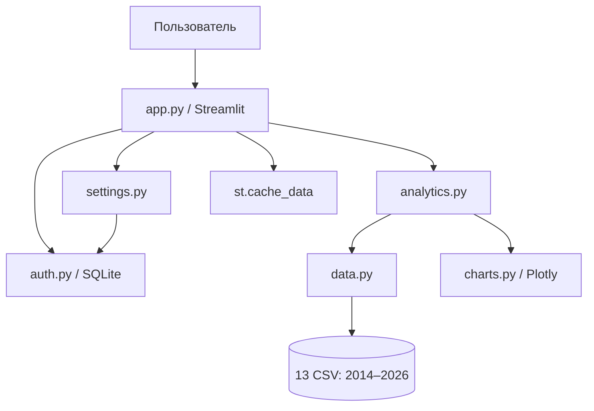

# Отчёт по РК-2

**Тема:** Разработка аналитического веб-приложения на Streamlit для анализа CVE-инцидентов за 2014–2026 гг.

## Цель

Реализовать многопользовательскую интерактивную информационно-аналитическую систему на Python и Streamlit для загрузки, фильтрации, визуализации и экспорта предоставленных CSV-данных.

## Архитектура

## Авторизация

Регистрация включает уникальный логин, e-mail, пароль и подтверждение. Пароли не хранятся в открытом виде; используется PBKDF2-HMAC-SHA256 со случайной солью. Страница аналитики и страница настроек недоступны без сессии авторизованного пользователя. Настройки каждого пользователя изолированы в SQLite.

## Настройки

Доступны выбор годов, типы атак, критичность, вектор, страна атакующего, отрасль-цель, порог CVSS и два дополнительных фильтра. Настройки сохраняются и сбрасываются.

## Аналитика

Четыре KPI: общее число записей, среднее значение CVSS, число Critical, суммарное число затронутых хостов. Построены четыре графика: динамика по годам; типы атак; топ-10 вендоров; тепловая карта тип × отрасль. Таблица поддерживает сортировку, текстовый поиск и экспорт CSV.

## Проверка целостности исходных данных

`fetch_datasets.py` скачивает оригинальные 13 CSV. Загрузчик сообщает об отсутствующих/непригодных файлах, валидирует обязательные поля и записи. Скрипт `scripts_check.py --strict --check-reference` проверяет все 13 файлов, число записей и контрольные суммы Git исходных данных преподавателя. Общее число строк в оригинальном наборе — 15 847. Операции фильтрации и графики работают на данных из валидных строк.

## Тестирование

Тесты включают регистрацию, пароль, изоляцию настроек двух пользователей, параллельное создание пользователей, некорректные CSV, фильтры, KPI и четыре графика. Дополнительно предусмотрены UI-тесты через `streamlit.testing.v1.AppTest`. В результате локальной проверки исходного кода: 20 тестов пройдены, UI-тесты пропущены, поскольку Streamlit не установлен в проверочной среде. На компьютере для сдачи необходимо выполнить UI-тесты и видеодемонстрацию. Запуск тестов: `python -m pytest -v`.

**Примечание:** результаты локального запуска `pytest`, проверки 13 CSV и видеозапись демонстрации следует приложить после выполнения проверок на компьютере, где установлен Streamlit. Не следует заявлять, что эти проверки пройдены, пока они не выполнены.

## Заключение

Разработано многопользовательское приложение с аутентификацией, индивидуальными настройками, аналитическими отчётами и обработкой ошибок входных данных. Приложение соответствует функциональной структуре задания и предусматривает автоматические и ручные сценарии проверки.
